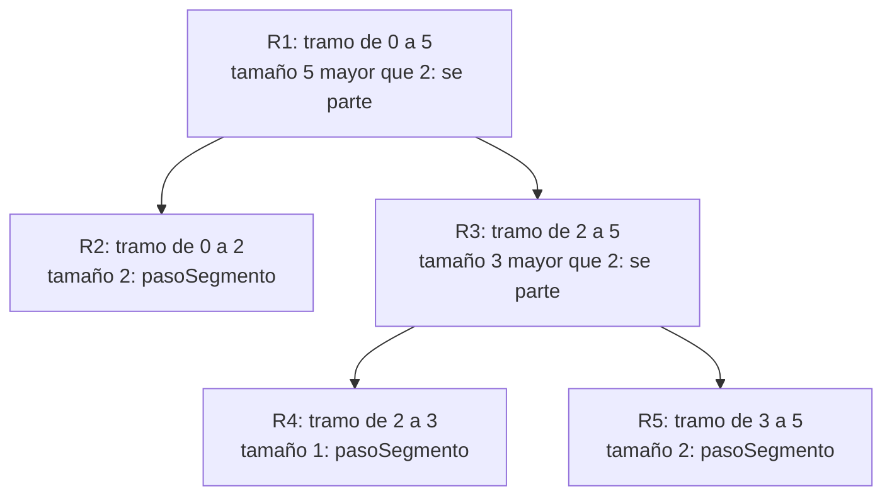
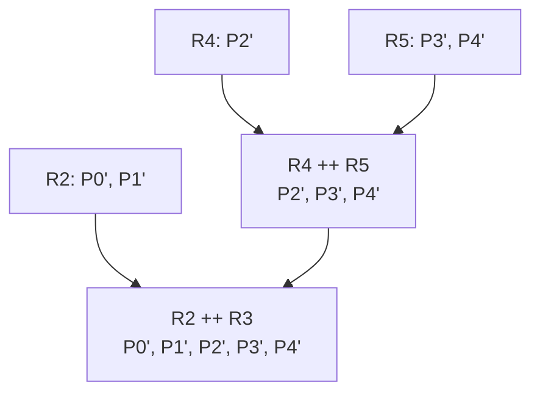

## Punto 1: un paso de la simulación

Un paso de la simulación hace una sola cosa: cada partícula se mueve según su velocidad. Su posición nueva es la anterior más la velocidad por el tiempo `dt`, y su velocidad y su masa se quedan como estaban. Lo interesante es que el cálculo de una partícula no depende de ninguna otra, y por eso el trabajo se puede repartir. Son cuatro funciones: `mover` hace el cálculo de una partícula, `pasoSegmento` lo hace para un tramo del arreglo, `pasoSecuencial` lo hace para todo el sistema y `pasoParalelo` parte el sistema en tramos que se calculan al mismo tiempo.

Para las trazas usamos un sistema pequeño de cinco partículas, numeradas desde cero. La partícula `i` está en `(i, 0)`, se mueve con velocidad `(1, 1)` y tiene masa 1. Con `dt = 2.0`, cada una debería terminar en `(i + 2, 2)`.

| i | Posición | Velocidad | Masa |
|---|----------|-----------|------|
| 0 | `(0, 0)` | `(1, 1)` | 1.0 |
| 1 | `(1, 0)` | `(1, 1)` | 1.0 |
| 2 | `(2, 0)` | `(1, 1)` | 1.0 |
| 3 | `(3, 0)` | `(1, 1)` | 1.0 |
| 4 | `(4, 0)` | `(1, 1)` | 1.0 |

### mover

```scala
def mover(p: Particula, dt: Double): Particula =
  Particula(p.pos + p.vel * dt, p.vel, p.masa)
```

Es el cálculo de una sola partícula, y los demás se apoyan en él. Primero multiplica la velocidad por `dt`, después le suma ese desplazamiento a la posición, y arma una partícula nueva con esa posición y con la misma velocidad y la misma masa. No se modifica ninguna partícula: cada llamado devuelve una nueva.

Traza con la partícula 3 y `dt = 2.0`:

| Paso | Operación | Resultado |
|------|-----------|-----------|
| 1 | `p.vel * dt` | `(1, 1) * 2.0 = (2, 2)` |
| 2 | `p.pos + (2, 2)` | `(3, 0) + (2, 2) = (5, 2)` |
| 3 | se arma la partícula nueva | `Particula((5, 2), (1, 1), 1.0)` |

### pasoSegmento

```scala
def pasoSegmento(s: Sistema, dt: Double, desde: Int, hasta: Int): Sistema = {
  val inicio = math.max(desde, 0)
  val fin = math.min(hasta, s.length)
  Array.tabulate(math.max(fin - inicio, 0))(i => mover(s(inicio + i), dt))
}
```

Avanza solo el tramo que empieza en `desde`, incluido, y termina en `hasta`, excluido, y devuelve un arreglo con solo esas partículas ya movidas. Funciona en tres pasos:

1. Recorta el tramo a los límites del arreglo, por si `desde` es negativo o `hasta` se pasa del final.
2. Calcula cuántas partículas tiene el tramo, que es `fin - inicio`, o cero si el tramo quedó vacío o al revés.
3. `Array.tabulate` arma un arreglo de esa longitud, y en la posición `i` pone la partícula `inicio + i` del sistema, ya movida con `mover`.

Traza con `pasoSegmento(s, 2.0, 1, 4)` sobre el sistema de arriba:

| Paso | Qué se calcula | Valor |
|------|----------------|-------|
| 1 | `inicio` y `fin` | `inicio = 1` y `fin = 4`, que están dentro del arreglo |
| 2 | largo del tramo | `4 - 1 = 3` |
| 3 | posición 0 del resultado | `mover(s(1), 2.0)`, que da `(3, 2)` |
| 4 | posición 1 del resultado | `mover(s(2), 2.0)`, que da `(4, 2)` |
| 5 | posición 2 del resultado | `mover(s(3), 2.0)`, que da `(5, 2)` |

El resultado tiene tres partículas, que son la 1, la 2 y la 3 ya movidas. La 0 y la 4 no aparecen porque quedaron fuera del tramo. Con `desde` igual a `hasta`, el largo es cero y el resultado es un arreglo vacío. Con `hasta = 100` sobre este sistema de cinco partículas, el paso 1 lo recorta a 5.

### pasoSecuencial

```scala
def pasoSecuencial(s: Sistema, dt: Double): Sistema =
  pasoSegmento(s, dt, 0, s.length)
```

El paso secuencial es el segmento que cubre todo el sistema, desde la posición 0 hasta el final. Se escribió así a propósito: el enunciado advierte que, si la versión secuencial y la paralela calculan cada tramo de maneras distintas, la diferencia de tiempos mide dos operaciones diferentes y no solo el reparto. Con esta definición, las dos versiones usan exactamente la misma función para calcular cada tramo.

Traza con `pasoSecuencial(s, 2.0)`: es `pasoSegmento(s, 2.0, 0, 5)`, que calcula las cinco partículas y devuelve las posiciones `(2, 2)`, `(3, 2)`, `(4, 2)`, `(5, 2)` y `(6, 2)`, que es lo que esperábamos.

### pasoParalelo

```scala
def pasoParalelo(s: Sistema, dt: Double, umbral: Int): Sistema = {
  val limite = math.max(umbral, 1)
  // Si todo el sistema cabe en el umbral no se reparte nada: se resuelve igual
  // que la versión secuencial.
  if (s.length <= limite) {
    pasoSegmento(s, dt, 0, s.length)
  } else {
    def repartir(desde: Int, hasta: Int): Sistema =
      if (hasta - desde <= limite) pasoSegmento(s, dt, desde, hasta)
      else {
        val medio = desde + (hasta - desde) / 2
        val (izquierda, derecha) =
          parallel(repartir(desde, medio), repartir(medio, hasta))
        izquierda ++ derecha
      }

    repartir(0, s.length)
  }
}
```

Esta función tiene cuatro partes.

La primera es `limite`, que es el umbral pero nunca menor que uno. Si el umbral fuera cero, un tramo de un solo elemento se seguiría partiendo para siempre, porque su mitad izquierda quedaría vacía y su mitad derecha sería ese mismo tramo.

La segunda es una revisión inicial: si todo el sistema cabe en el umbral, es decir, si `s.length` no pasa de `limite`, no hay nada que repartir y se calcula de una vez con `pasoSegmento(s, dt, 0, s.length)`, que es justo lo que hace `pasoSecuencial`. Esta revisión no cambia lo que se calcula, porque si se saltara, el primer llamado de `repartir` caería en su caso base y haría esa misma llamada. Lo que hace es dejar explícito el caso en que no se reparte nada, que es el caso de control de las mediciones.

La tercera es la función interna `repartir`, que solo se define cuando el sistema sí pasa del umbral. Trabaja sobre el tramo que va de `desde` a `hasta`, y tiene dos casos:

* Si el tramo no pasa del umbral, se calcula directamente con `pasoSegmento`. Es el caso base: ahí no se reparte nada.
* Si el tramo pasa del umbral, se calcula el punto medio, `desde + (hasta - desde) / 2`, y se parten dos tramos: de `desde` a `medio` y de `medio` a `hasta`. Con `parallel`, la mitad derecha se entrega como una tarea para que la haga otro hilo, mientras el hilo que llama se ocupa de la izquierda. Cuando las dos terminan, se pegan con `izquierda ++ derecha`.

La cuarta es la llamada inicial, `repartir(0, s.length)`, que arranca con el sistema completo.

La división del medio se escribe como `desde + (hasta - desde) / 2` y no como `(desde + hasta) / 2` para que la suma no se pase del límite de un entero cuando el arreglo es muy grande. Cuando el tramo tiene tamaño impar, la mitad izquierda se queda con el piso de la mitad y la derecha con el resto, por ejemplo 2 y 3 para un tramo de 5.

Traza con el sistema de cinco partículas, `dt = 2.0` y `umbral = 2`. Cada fila es un llamado a `repartir`:

| Llamado | Tramo | Tamaño | ¿Pasa del umbral (2)? | Qué hace |
|---------|-------|--------|-----------------------|----------|
| R1 | de 0 a 5 | 5 | sí | `medio = 0 + 5/2 = 2`: parte en los tramos de 0 a 2 y de 2 a 5 |
| R2 | de 0 a 2 | 2 | no | resuelve con `pasoSegmento` y devuelve P0 y P1 ya movidas |
| R3 | de 2 a 5 | 3 | sí | `medio = 2 + 3/2 = 3`: parte en los tramos de 2 a 3 y de 3 a 5 |
| R4 | de 2 a 3 | 1 | no | resuelve con `pasoSegmento` y devuelve P2 ya movida |
| R5 | de 3 a 5 | 2 | no | resuelve con `pasoSegmento` y devuelve P3 y P4 ya movidas |

Aquí `Pi` es la partícula `i` y `Pi'` es la misma partícula ya movida, que queda en `(i + 2, 2)`. Estos tramos no son una suposición: los registramos ejecutando la función real y quedaron exactamente así.



Las hojas del árbol son R2, R4 y R5, y son los llamados que de verdad calculan partículas. Sus tramos, de 0 a 2, de 2 a 3 y de 3 a 5, tienen 2, 1 y 2 partículas, que suman las 5 del sistema, y ninguna aparece en dos hojas. Esto es justo lo que se demuestra en el informe de corrección.

El reparto se hace hacia abajo, partiendo el tramo. Los resultados se combinan hacia arriba, y en ese orden:

| Paso | Qué se une | Resultado |
|------|------------|-----------|
| 1 | R4 y R5, con `++` | `P2', P3', P4'`, que es el resultado del tramo de 2 a 5 |
| 2 | R2 y el resultado del paso 1, con `++` | `P0', P1', P2', P3', P4'` |

Con las posiciones, el resultado final es `(2, 2)`, `(3, 2)`, `(4, 2)`, `(5, 2)` y `(6, 2)`, igual que el de `pasoSecuencial`.



Lo que importa de la unión es el orden: siempre va la izquierda antes que la derecha. Si en algún `++` se invirtieran, las partículas quedarían en posiciones cambiadas, aunque ninguna se perdiera.

Cómo cambia el reparto con el umbral, para un sistema de cinco y de siete partículas. Los tramos son los de las hojas del árbol, registrados al ejecutar la función real:

| Partículas | Umbral | Tramos que se calculan directamente |
|------------|--------|--------------------------------------|
| 5 | 1 | de 0 a 1, de 1 a 2, de 2 a 3, de 3 a 4, de 4 a 5 (cinco tramos) |
| 5 | 2 | de 0 a 2, de 2 a 3, de 3 a 5 (tres tramos) |
| 5 | 5 o más | de 0 a 5 (un solo tramo: no se reparte nada) |
| 7 | 2 | de 0 a 1, de 1 a 3, de 3 a 5, de 5 a 7 (cuatro tramos) |
| 5 | 0 | igual que con umbral 1, porque el umbral nunca baja de uno |

Con un umbral que cubre todo el sistema, que es el caso de control que pide el enunciado, la revisión inicial lo detecta y la función nunca se parte: calcula directamente el tramo de 0 a `n`, que es exactamente lo que hace `pasoSecuencial`. Por eso en ese caso las dos versiones hacen el mismo trabajo, y la aceleración medida tiene que dar 1.

Una última observación: cada vez que se parte un tramo se lanza una tarea nueva para su mitad derecha, y cada `++` copia los elementos de las dos mitades en un arreglo nuevo. Mientras más pequeño es el umbral, más tareas se lanzan y más veces se copian los datos. Ese costo del reparto es el que el informe de paralelización compara contra lo que se ahorra.

## Punto 2: corrección de energiaSecuencial, masaTotal y centroDeMasaSecuencial

### Notación

Sea $s = (p_0, \ldots, p_{n-1})$ el sistema, con $p_i = (x_i, v_i, m_i)$
(posición, velocidad y masa). La norma de un vector es
$\lVert v \rVert = \sqrt{v_x^2 + v_y^2}$. Las operaciones de `Vector2` actúan
coordenada a coordenada: $(a + b) = (a_x + b_x,\ a_y + b_y)$ y
$v \ast k = (k\,v_x,\ k\,v_y)$. Todas las sumas son sobre $i = 0, \ldots, n-1$
y la suma vacía vale $0$.

Estas son las mismas magnitudes del Punto 3 sobre todo el sistema, es decir
$E(s) = E(0,n)$, $W(s) = W(0,n)$ y $M(s) = M(0,n)$:

$$
E(s) = \sum_{i} \tfrac{1}{2}\, m_i\, \lVert v_i \rVert^2
\qquad
W(s) = \sum_{i} m_i\, x_i
\qquad
M(s) = \sum_{i} m_i
$$

### 1. Especificación

El enunciado pide $\text{energiaSecuencial}(s) = E(s)$,
$\text{masaTotal}(s) = M(s)$ y

$$
\text{centroDeMasaSecuencial}(s) = \begin{cases}
\dfrac{W(s)}{M(s)} & \text{si } M(s) \neq 0 \\
(0,\ 0) & \text{si } M(s) = 0
\end{cases}
$$

### 2. El programa

```scala
def energiaSecuencial(s: Sistema): Double = {
  val energias = s.map(particula => 0.5 * particula.masa * particula.vel.norma * particula.vel.norma)
  energias.sum
}

def masaTotal(s: Sistema): Double = {
  val masas = s.map(particula => particula.masa)
  masas.sum
}

def centroDeMasaSecuencial(s: Sistema): Vector2 = {
  val masa = masaTotal(s)
  if (masa == 0.0) Vector2(0.0, 0.0)
  else {
    val ponderadas = s.map(particula => particula.pos * particula.masa)
    val suma = ponderadas.foldLeft(Vector2(0.0, 0.0))((acumulado, v) => acumulado + v)
    Vector2(suma.x / masa, suma.y / masa)
  }
}
```

### 3. Tres hechos sobre las operaciones que se usan

**Lema 2.1 (map).** Si $a = (a_0, \ldots, a_{n-1})$ y $f$ es una función,
entonces `a.map(f)` es $(f(a_0), \ldots, f(a_{n-1}))$: el mismo largo y cada
resultado en la misma posición. Es la definición de `map`.

**Lema 2.2 (sum).** Para $a = (a_0, \ldots, a_{n-1})$ de números, `a.sum` es
la suma de todos sus elementos:

$$
\text{a.sum} = \sum_{i=0}^{n-1} a_i
$$

_Demostración._ Por inducción sobre $n$. `sum` suma los elementos de a uno,
de izquierda a derecha, empezando en $0$.

**Caso base:** $n = 0$. No hay elementos y el resultado es el valor inicial
$0$, que es la suma vacía.

**Caso de inducción:** $n = k + 1$. La suma de $(a_0, \ldots, a_k)$ es la suma
de los primeros $k$ elementos más $a_k$. Por la hipótesis de inducción (HI),
la suma de los primeros $k$ elementos es:

$$
\sum_{i=0}^{k-1} a_i
$$

y entonces el total es:

$$
\sum_{i=0}^{k-1} a_i + a_k = \sum_{i=0}^{k} a_i
$$

**Lema 2.3 (foldLeft con la suma de vectores).** Sean $w_0, \ldots, w_{n-1}$
vectores. El `foldLeft` que empieza en `Vector2(0.0, 0.0)` y suma cada vector
al acumulado da:

$$
\sum_{i=0}^{n-1} w_i
$$

_Demostración._ Igual que el Lema 2.2, con el vector $(0, 0)$ como valor
inicial y la suma coordenada a coordenada.

**Caso base:** $n = 0$. Sin elementos queda $(0, 0)$, la suma vacía.

**Caso de inducción:** $n = k + 1$. El acumulado de $k + 1$ elementos es el
acumulado de los primeros $k$ más $w_k$. Por la HI, el acumulado de los
primeros $k$ es:

$$
\sum_{i=0}^{k-1} w_i
$$

y entonces el total es:

$$
\sum_{i=0}^{k-1} w_i + w_k = \sum_{i=0}^{k} w_i
$$

### 4. Corrección de cada función

**Teorema 2.1.** Para todo sistema $s$, $\text{energiaSecuencial}(s) = E(s)$.

_Demostración._ Por el Lema 2.1, `energias` es la lista con
$e_i = 0.5 \cdot m_i \cdot \lVert v_i \rVert \cdot \lVert v_i \rVert = \tfrac12 m_i \lVert v_i \rVert^2$.
Por el Lema 2.2, `energias.sum` es $\sum_i e_i = E(s)$. Para $s$ vacío el
resultado es $0 = E(s)$.

**Teorema 2.2.** Para todo sistema $s$, $\text{masaTotal}(s) = M(s)$.

_Demostración._ Por el Lema 2.1, `masas` es $(m_0, \ldots, m_{n-1})$ y por el
Lema 2.2 su suma es $\sum_i m_i = M(s)$.

**Teorema 2.3.** Para todo sistema $s$, $\text{centroDeMasaSecuencial}(s)$ es
la especificación de la sección 1.

_Demostración._ Por casos sobre `masa`, que por el Teorema 2.2 es $M(s)$.

- **$M(s) = 0$.** El programa devuelve $(0, 0)$, que es lo pedido. Esto incluye
  el sistema vacío y también un sistema con partículas cuyas masas suman cero.
  En este caso no se divide, así que nunca se calcula $0/0$.
- **$M(s) \neq 0$.** Por el Lema 2.1, `ponderadas` es la lista de vectores
  $w_i = x_i \ast m_i = (m_i x_{i,x},\ m_i x_{i,y})$. Por el Lema 2.3,
  `suma` es $\sum_i m_i\, x_i = W(s)$. El programa devuelve
  $(\text{suma}_x / M,\ \text{suma}_y / M) = W(s)/M(s)$, porque dividir el
  vector entre $M$ es dividir cada coordenada.

Comprobación con $s = ((0,0),(3,4),2),\ ((4,0),(0,0),2)$:

| Magnitud | Cálculo | Resultado |
|---|---|:---:|
| $E(s)$ | $\tfrac12 \cdot 2 \cdot 5^2 + \tfrac12 \cdot 2 \cdot 0^2$ | $25$ |
| $M(s)$ | $2 + 2$ | $4$ |
| $W(s)/M(s)$ | $\tfrac14\,\bigl(2\,(0,0) + 2\,(4,0)\bigr) = \tfrac14 (8, 0)$ | $(2,\ 0)$ |

que coincide con los ejemplos del enunciado.

### 5. Sobre los números de punto flotante

Los argumentos anteriores son exactos sobre los reales. En `Double`, sumar en
otro orden puede cambiar el resultado en las últimas cifras (ver la
observación sobre los `Double` del Punto 3), por eso las pruebas comparan con
una tolerancia pequeña. Que la suma sea asociativa sobre los reales es lo que
permite repartirla en el Punto 3: estas versiones secuenciales son la
especificación con la que se compara la versión paralela.


## Punto 3: corrección de energiaParalela y centroDeMasaParalelo

### Notación

Sea $s = (p_0, \ldots, p_{n-1})$ el sistema, con $p_i = (x_i, v_i, m_i)$ (posición, velocidad y masa). Para $0 \le a \le b \le n$ el **segmento** $[a, b)$ son los índices $a, a+1, \ldots, b-1$, y su longitud es $\ell = b - a$. Se definen las magnitudes de un segmento:

$$
E(a,b) = \sum_{i=a}^{b-1} \tfrac{1}{2}\, m_i \lVert v_i \rVert^2
\qquad
W(a,b) = \sum_{i=a}^{b-1} m_i\, x_i
\qquad
M(a,b) = \sum_{i=a}^{b-1} m_i
$$

Con la convención de que una suma vacía vale $0$. Las especificaciones del enunciado son $energiaSecuencial(s) = E(0,n)$ y $centroDeMasaSecuencial(s) = W(0,n)/M(0,n)$ si $M(0,n) \neq 0$, y el origen si $M(0,n) = 0$.

### 1. Partir el sistema en segmentos no pierde ni repite partículas

Sea $[a,b)$ un segmento que se parte, es decir, con $\ell > umbral$ y $\ell > 1$. El programa toma $medio = a + \lfloor \ell/2 \rfloor$ y llama a los segmentos $[a, medio)$ y $[medio, b)$.

- Como $\ell \ge 2$, se tiene $\lfloor \ell/2 \rfloor \ge 1$ y $\lfloor \ell/2 \rfloor < \ell$, luego $a < medio < b$.
- **No se pierde ninguna:** $[a, medio) \cup [medio, b) = [a, b)$, porque todo índice $i$ con $a \le i < b$ cumple $i < medio$ o $i \ge medio$.
- **No se repite ninguna:** $[a, medio) \cap [medio, b) = \emptyset$, porque ningún $i$ cumple a la vez $i < medio$ e $i \ge medio$.
- Las longitudes son $\lfloor \ell/2 \rfloor$ y $\lceil \ell/2 \rceil$, ambas estrictamente menores que $\ell$.
  Por lo tanto, cada segmento se descompone en una **partición** de sí mismo, y de la partición se sigue que cualquier suma sobre $[a,b)$ es la suma de las sumas sobre las dos partes:

$$
E(a,b) = E(a,medio) + E(medio,b)
\qquad
W(a,b) = W(a,medio) + W(medio,b)
\qquad
M(a,b) = M(a,medio) + M(medio,b)
$$

**Terminación.** Cada llamado recursivo trabaja sobre un segmento de longitud estrictamente menor, así que la longitud (un natural) decrece y se llega a $\ell \le 1$ o a $\ell \le umbral$, donde no se parte más. La condición $\ell > 1$ es la que garantiza esto cuando $umbral \le 0$: sin ella, un segmento de longitud $1$ se partiría en uno vacío y uno igual a sí mismo, y la recursión no terminaría.

### 2. Corrección de energiaParalela

**Versión iterativa de acumular (estado, invariante y transformación).** Dentro de cada tramo $[a,b)$, la función auxiliar acumular recorre los índices uno a uno. Es una recursión de cola, así que se argumenta como un programa iterativo:

- **Estado:** $(i, acc)$, con el índice $i$ que falta por sumar y el acumulado $acc$.
- **Estado inicial:** $s_0 = (a, 0.0)$.
- **Estado final:** $(i, acc)$ es final si $i \geq b$, y como $i$ solo crece de uno en uno, esto equivale a $i = b$. La respuesta es $acc$.
- **Invariante:**
  $$
  \text{Inv}(i, acc) \equiv a \leq i \leq b \;\land\; acc = \sum_{k=a}^{i-1} \tfrac{1}{2}\, m_k \lVert v_k \rVert^2 = E(a,i)
  $$

- **Transformación:** $\text{transformar}((i, acc)) = \big(i+1,\; acc + \tfrac{1}{2}\, m_i \lVert v_i \rVert^2\big)$.
  Demostración:

**1.** $\text{Inv}(s_0)$: el estado inicial cumple la invariante.

$$
s_0 = (a, 0.0) \implies a \leq a \leq b \;\land\; 0 = E(a,a)
$$

porque la suma vacía vale $0$.

**2.** La invariante se mantiene: $(s_i \neq s_f \land \text{Inv}(s_i)) \rightarrow \text{Inv}(\text{transformar}(s_i))$. Si $i < b$ y vale la invariante:

1. Primer cambio, $i + 1$: se cumple $a \leq i + 1 \leq b$, porque $i < b$.
2. Segundo cambio, $acc + \tfrac{1}{2} m_i \lVert v_i \rVert^2 = E(a,i) + \tfrac{1}{2} m_i \lVert v_i \rVert^2 = E(a, i+1)$.
3. Los dos cambios dejan el estado cumpliendo $\text{Inv}(i+1, acc')$.
   **3.** $\text{Inv}(s_f) \rightarrow \text{respuesta}(s_f) = E(a,b)$:

$$
(i = b) \;\land\; acc = E(a,b) \rightarrow acc = E(a,b)
$$

**4.** Siempre se llega al estado final: en cada paso $i$ aumenta en uno y está acotado por $b$, así que después de $b - a$ pasos se tiene $i = b$.

Luego acumular(a, 0.0) $= E(a,b)$.

**Teorema.** Para todo segmento $[a,b)$ y todo umbral, energiaTramo(a, b) $= E(a,b)$.
*Demostración por inducción fuerte sobre $\ell = b - a$.*

- **Caso sin partir** ($\ell \le umbral$ o $\ell \le 1$, incluye $\ell = 0$): el programa devuelve acumular(a, 0.0) $= E(a,b)$ por la demostración anterior.
- **Caso de partir** ($\ell > umbral$ y $\ell > 1$): parallel devuelve la pareja formada por energiaTramo(a, medio) y energiaTramo(medio, b); como ambos segmentos son más cortos que $\ell$, por hipótesis de inducción valen $E(a, medio)$ y $E(medio, b)$. El resultado es su suma, que por la sección 1 es $E(a,b)$. $\square$
  Como energiaParalela(s, umbral) es energiaTramo(0, n), se concluye:

$$
\forall s,\ \forall umbral:\quad energiaParalela(s, umbral) = E(0,n) = energiaSecuencial(s)
$$

### 3. Corrección de centroDeMasaParalelo

Se define la pareja parcial $P(a,b) = \big(W(a,b),\ M(a,b)\big)$ y la operación $\oplus$ sobre parejas:

$$
(W_1, M_1) \oplus (W_2, M_2) = (W_1 + W_2,\ M_1 + M_2)
$$

Igual que en la sección 2, por la argumentación de acumular (ahora con la pareja $(W, M)$ como acumulado, que se actualiza sumando $m_i\, x_i$ y $m_i$) y por inducción fuerte sobre $\ell$, parcial(a, b) $= P(a,b)$: en el caso de partir, por la sección 1, $P(a,b) = P(a,medio) \oplus P(medio,b)$, que es lo que combina el programa. Al final el programa divide **una sola vez**:

$$
centroDeMasaParalelo(s, umbral) =
\begin{cases}
\dfrac{W(0,n)}{M(0,n)} & \text{si } M(0,n) \neq 0 \\[2mm]
(0,0) & \text{si } M(0,n) = 0
\end{cases}
$$

que es exactamente la especificación de centroDeMasaSecuencial. Es decir, $\forall s,\ \forall umbral:\ centroDeMasaParalelo(s, umbral) = centroDeMasaSecuencial(s)$.

### 4. La operación que combina los resultados parciales es asociativa

- **Energía:** la operación es la suma de números reales, $(x + y) + z = x + (y + z)$.
- **Centro de masa:** $\oplus$ actúa componente a componente con sumas de reales. Para parejas $(W_i, M_i)$:
  $$
  \big((W_1,M_1) \oplus (W_2,M_2)\big) \oplus (W_3,M_3)
  = (W_1+W_2+W_3,\ M_1+M_2+M_3)
  = (W_1,M_1) \oplus \big((W_2,M_2) \oplus (W_3,M_3)\big)
  $$

Además $\oplus$ tiene elemento neutro $(0,0)$ (el resultado de un tramo vacío). Por eso da igual cómo se agrupen los segmentos: el árbol de llamados puede tener cualquier forma y el resultado es el mismo.

**Observación sobre los Double.** La asociatividad es exacta en $\mathbb{R}$. Con aritmética de punto flotante (IEEE 754) la suma no es exactamente asociativa, por lo que la versión paralela, que suma en otro orden que la secuencial, puede diferir en el último dígito. La diferencia es del orden del error de redondeo y por eso las pruebas comparan con una tolerancia pequeña y no con igualdad exacta.

### 5. Por qué la suma sirve para repartir y el promedio no

Sea $C(a,b) = W(a,b)/M(a,b)$ el centro de masa de un segmento, con $M_L = M(a,medio)$ y $M_R = M(medio,b)$. Entonces:

$$
C(a,b) = \frac{W_L + W_R}{M_L + M_R}
= \frac{M_L\, C_L + M_R\, C_R}{M_L + M_R}
$$

es un promedio **ponderado** por las masas de cada mitad. Solo coincide con el promedio simple $\tfrac{1}{2}(C_L + C_R)$ cuando $M_L = M_R$.

- **La suma sí sirve** porque las magnitudes $E$, $W$ y $M$ son sumas sobre los elementos, y una suma sobre una partición es la suma de las sumas de las partes (sección 1). Cada mitad se calcula sin saber nada de la otra y la combinación es exacta.
- **El promedio no sirve directamente** porque el promedio de un conjunto no se obtiene del promedio de sus partes sin saber cuánto pesa cada una. Además la operación $\mathrm{prom}(x, y) = \tfrac{x+y}{2}$ ni siquiera es asociativa: $\mathrm{prom}(\mathrm{prom}(0,0), 9) = 4.5$ pero $\mathrm{prom}(0, \mathrm{prom}(0, 9)) = 2.25$, así que el resultado dependería de cómo se parta el sistema.
  **Contraejemplo del sistema de tres partículas** (posiciones $(1,2)$, $(5,6)$, $(-3,0)$ y masas $1$, $3$, $4$): el centro de masa es $(0.5, 2.5)$, pero el promedio de los centros de las mitades $\{p_0\}$ y $\{p_1, p_2\}$ es $(\tfrac{5}{7}, \tfrac{16}{7}) \neq (0.5, 2.5)$. Llevando $(W, M)$ y dividiendo una sola vez al final, se obtiene $(4, 20)/8 = (0.5, 2.5)$, el valor correcto.
## Punto 4: corrección de trabajo, profundidad y tiempoEstimado

### 1. Especificación

Sea $n \geq 0$ el número de partículas, $u$ el umbral y $p \geq 1$ el número de
procesadores (en esta sección $p$ es el número de procesadores). Se toma
$\ell = \max(u, 1)$, porque un umbral menor que uno partiría para siempre un
tramo de un solo elemento.

`pasoParalelo` parte un tramo de $m$ elementos, con $m \gt \ell$, en dos mitades
de $\lfloor m/2 \rfloor$ y $\lceil m/2 \rceil$ elementos, y no parte los tramos
de $\ell$ elementos o menos. Se sigue la mitad mayor, $\lceil m/2 \rceil$. Lo
que pide el enunciado es:

$$
\text{Trab}(n) = n
$$

$$
\text{Prof}(n, u) = \begin{cases}
n & \text{si } n \leq \ell \\
1 + \text{Prof}\bigl(\lceil n/2 \rceil,\ u\bigr) & \text{si } n \gt \ell
\end{cases}
$$

$$
\text{Est}(n, p, u) = \text{Prof}(n, u) + \frac{\text{Trab}(n)}{p}
$$

### 2. El programa

```scala
def trabajo(n: Int): Int = n

def profundidad(n: Int, umbral: Int): Int = {
  val limite = math.max(umbral, 1)
  if (n <= limite) trabajo(n)
  else 1 + profundidad((n + 1) / 2, limite)
}

def tiempoEstimado(n: Int, p: Int, umbral: Int): Double = {
  val prof = profundidad(n, umbral)
  val repartido = trabajo(n).toDouble / p
  prof + repartido
}
```

### 3. El trabajo no baja por repartirlo

**Teorema 4.1.** Si un tramo de $n$ elementos se parte según la regla de
`pasoParalelo`, la suma de los trabajos de sus hojas es $n$.

_Demostración._ Por inducción fuerte sobre $n$.

**Caso base:** $n \leq \ell$. El tramo no se parte, es una sola hoja y cuesta
$n$.

**Caso de inducción:** $n \gt \ell$. Se parte en $\lfloor n/2 \rfloor$ y
$\lceil n/2 \rceil$, ambos menores que $n$ porque $n \geq 2$. Por la hipótesis
de inducción (HI), las hojas de cada mitad suman $\lfloor n/2 \rfloor$ y
$\lceil n/2 \rceil$, y

$$
\lfloor n/2 \rfloor + \lceil n/2 \rceil = n
$$

Repartir no reduce el trabajo, que sigue siendo $\text{Trab}(n) = n$. Solo
cambia cuánto de ese trabajo se hace al mismo tiempo.

### 4. profundidad cumple la especificación

**Teorema 4.2.** Para todo $n \geq 0$ y todo $u$,
$\text{profundidad}(n, u) = \text{Prof}(n, u)$.

_Demostración._ Por inducción fuerte sobre $n$. El programa calcula $\ell$ con
`limite` $= \max(u, 1)$. En el llamado recursivo el parámetro es `limite`, y
$\max(\text{limite}, 1) = \text{limite}$ porque $\text{limite} \geq 1$, así que
$\ell$ no cambia entre llamados.

**Caso base:** $n \leq \ell$. El programa devuelve $\text{trabajo}(n) = n$, que
es $\text{Prof}(n, u)$.

**Caso de inducción:** $n \gt \ell$. El programa devuelve
$1 + \text{profundidad}((n+1)/2,\ \ell)$ con división entera. Se tiene
$(n+1)/2 = \lceil n/2 \rceil$: si $n = 2k$, $(2k+1)/2 = k$; si $n = 2k+1$,
$(2k+2)/2 = k+1$. Como $n \gt \ell \geq 1$, se tiene $n \geq 2$ y entonces
$\lceil n/2 \rceil \lt n$, así que la HI se aplica al llamado y da
$\text{Prof}(\lceil n/2 \rceil, u)$. El resultado es
$1 + \text{Prof}(\lceil n/2 \rceil, u) = \text{Prof}(n, u)$.

La recursión termina porque el tamaño baja en cada llamado y, en algún momento,
llega a ser $\leq \ell$.

### 5. Forma cerrada

Sea $n_0 = n$ y $n_{j+1} = \lceil n_j / 2 \rceil$. Con la identidad
$\lceil \lceil n/a \rceil / b \rceil = \lceil n/(ab) \rceil$ para enteros
positivos, $n_j = \lceil n / 2^j \rceil$. Sea $k$ el número de particiones, es
decir, el primer $j$ con $n_j \leq \ell$:

$$
k = \min\{\, j \geq 0 \mid \lceil n/2^j \rceil \leq \ell \,\}
= \begin{cases} 0 & \text{si } n \leq \ell \\ \lceil \log_2 (n/\ell) \rceil & \text{si } n \gt \ell \end{cases}
$$

$$
\text{Prof}(n, u) = k + \lceil n / 2^k \rceil
$$

La segunda igualdad de $k$ vale porque $\ell$ es entero:
$\lceil n/2^j \rceil \leq \ell \iff n/2^j \leq \ell \iff 2^j \geq n/\ell$.

Comprobación con los ejemplos del enunciado y con otros propios:

| $n$ | $u$ | $\ell$ | $k$ | $\lceil n/2^k \rceil$ | $\text{Prof}(n, u) = k + \lceil n/2^k \rceil$ |
|---:|---:|---:|---:|---:|---:|
| 1024 | 1024 | 1024 | 0 | 1024 | 1024 |
| 1024 | 512 | 512 | 1 | 512 | 513 |
| 1024 | 1 | 1 | 10 | 1 | 11 |
| 1000 | 250 | 250 | 2 | 250 | 252 |
| 100 | 3 | 3 | 6 | 2 | 8 |

### 6. Propiedades de la profundidad

**Lema 4.1.** $\text{Prof}(n, u) \leq \text{Trab}(n)$ para todo $n \geq 0$.

_Demostración._ Por inducción fuerte. Si $n \leq \ell$, $\text{Prof} = n = \text{Trab}$.
Si $n \gt \ell$, $n \geq 2$ y $\lceil n/2 \rceil \leq n - 1$, así que por la HI

$$
\text{Prof}(n, u) = 1 + \text{Prof}(\lceil n/2 \rceil, u) \leq 1 + \lceil n/2 \rceil \leq n
$$

**Lema 4.2.** El número de particiones $k(n)$ no decrece cuando $n$ crece.

_Demostración._ $\lceil n/2^j \rceil$ no decrece con $n$. Entonces, si
$n \leq m$ y $\lceil m/2^j \rceil \leq \ell$, también
$\lceil n/2^j \rceil \leq \ell$, y el primer $j$ que sirve para $m$ sirve para
$n$.

El Lema 4.2 es por lo que se sigue la mitad mayor: es la que más se parte.

**Observación.** $\text{Prof}$ es un modelo: cuenta las particiones de la mitad
mayor y suma el tramo que queda en ella. No siempre es el camino más largo del
árbol de `pasoParalelo`, porque la mitad menor puede terminar en una hoja más
grande. Por ejemplo, con $n = 21$ y $u = 10$ las mitades son 10 y 11. La de 10
no se parte y cuesta 10, y la de 11 se parte y cuesta
$\text{Prof}(11, 10) = 1 + 6 = 7$. El modelo da $\text{Prof}(21, 10) = 1 + 7 = 8$,
y el camino más largo es $1 + 10 = 11$. Para tamaños que se dividen exacto,
como los del enunciado, las dos cuentas coinciden.

### 7. tiempoEstimado

**Teorema 4.3.** Para $n \geq 0$ y $p \geq 1$,
$\text{tiempoEstimado}(n, p, u) = \text{Est}(n, p, u)$.

_Demostración._ El programa calcula $\text{prof} = \text{Prof}(n, u)$ por el
Teorema 4.2 y $\text{repartido} = \text{trabajo}(n).\text{toDouble}/p = \text{Trab}(n)/p$.
El `toDouble` hace que la división sea real y no entera. Devuelve su suma.


De la fórmula salen dos consecuencias:

- $\text{Est}(n, p, u) \geq \text{Prof}(n, u)$ para todo $p$, porque
  $\text{Trab}(n)/p \geq 0$. Agregar procesadores nunca baja el tiempo estimado
  de la profundidad.
- $\text{Est}(n, 1, u) = \text{Prof}(n, u) + n$, y $\text{Est}$ baja cuando $p$
  sube.

Comprobación: $\text{Est}(1024, 4, 1) = 11 + 1024/4 = 267$ y
$\text{Est}(1000, 8, 250) = 252 + 1000/8 = 377$, que coinciden con el enunciado
y con el caso propio.


## Punto 5: medir la aceleración

Sea $n$ el tamaño del sistema $s$, y sea $T(u)$ el tiempo que mide `medir` para
`pasoParalelo(s, dt, u)`.

### Especificación

```scala
def aceleracion(tSecuencial: Double, tParalelo: Double): Double
def umbralConveniente(s: Sistema, dt: Double, umbrales: List[Int]): Int
```

`aceleracion` es el cociente entre los dos tiempos. `umbralConveniente` devuelve
el umbral de la lista que menos tarda y, con la lista vacía, el tamaño del
sistema. Además, `App.scala` usa como control el umbral igual a $n$.

### Corrección de `aceleracion`

```scala
def aceleracion(tSecuencial: Double, tParalelo: Double): Double =
  tSecuencial / tParalelo
```

Para $t_s, t_p$ con $t_p > 0$, la especificación es

```math
S(t_s, t_p) = \frac{t_s}{t_p}
```

El cuerpo de la función es esa misma expresión, así que
$\text{aceleracion}(t_s, t_p) = S(t_s, t_p)$ por sustitución. De la definición
se siguen los casos que usa el informe de paralelización:

```math
S(t, t) = 1
\qquad
S\!\left(t, \tfrac{t}{k}\right) = k
\qquad
S(a, b) \cdot S(b, a) = \frac{a}{b} \cdot \frac{b}{a} = 1 \quad (a, b \neq 0)
```

- Si $t_s = t_p$, entonces $S = 1$.
- Si $t_s > t_p$, entonces $S > 1$: el tiempo paralelo fue menor.
- Si $t_s < t_p$, entonces $S < 1$: el tiempo paralelo fue mayor.

La función solo divide los dos valores que recibe: no mide tiempos ni depende
del tamaño del sistema. Los tiempos de ScalaMeter son positivos, así que el
caso $t_p = 0$, que en punto flotante daría infinito, no aparece.

### Corrección de `umbralConveniente`

```scala
def umbralConveniente(s: Sistema, dt: Double, umbrales: List[Int]): Int =
  if (umbrales.isEmpty) s.length
  else {
    val tiempos = umbrales.map(u => (medir(5)(pasoParalelo(s, dt, u)), u))
    tiempos.minBy(_._1)._2
  }
```

Sea $U = [u_1, \ldots, u_k]$ la lista de candidatos. El resultado $u^*$ debe
cumplir:

- Si $U = \emptyset$, entonces $u^* = n$.
- Si $U \neq \emptyset$, entonces $u^* \in U$ y $\forall u \in U : T(u^*) \le T(u)$.

*Caso $U = \emptyset$.* La condición `umbrales.isEmpty` es verdadera y la
función devuelve `s.length`, que es $n$.

*Caso $U \neq \emptyset$.* La función construye la lista de parejas

```math
L = [(T(u_1), u_1), \ldots, (T(u_k), u_k)]
```

`map` conserva el número de elementos y cada pareja lleva su candidato como
segunda componente. `minBy(_._1)` devuelve una pareja $(t^*, u^*)$ de $L$ cuyo
primer componente es el menor. Se comprueba por inducción sobre la longitud
$j$ de la lista:

- **Caso base**, $j = 1$: la lista tiene una sola pareja, y esa es la menor.
- **Paso**: sea $m$ la pareja que `minBy` escoge entre las primeras $j$, y por
  hipótesis de inducción $t_m \le t_i$ para esas $j$. Al llegar la pareja
  $j + 1$ se compara con $m$. Si $t_{j+1} < t_m$ se queda con ella, y entonces
  $t_{j+1} < t_m \le t_i$ para todas las anteriores. Si no, se queda con $m$,
  que ya era menor o igual que todas las anteriores y que la nueva.

Por lo tanto $t^* \le T(u)$ para todo $u \in U$, y como $u^*$ es la segunda
componente de una pareja de $L$, pertenece a $U$. Si dos candidatos empatan,
`minBy` conserva el primero de la lista.

**Alcance.** $T$ es una medición y fluctúa de una corrida a otra. Lo que se
demuestra es que el resultado es el mejor de los tiempos medidos dentro de esa
llamada, una vez por candidato. No se afirma que vuelva a serlo en otra
ejecución. Por eso `umbralConveniente` y el mejor umbral de la tabla de
`App.scala` pueden diferir, porque cada uno hace su propia medición.

### La combinación de resultados parciales es asociativa

**Escoger el menor.** `minBy` pliega la lista con la operación $\sqcap$ que, de
dos parejas, deja la de menor tiempo y, si empatan, la de más a la izquierda.
Es el mínimo según el orden total $(t, \text{posición})$, y el mínimo de un
orden total es asociativo:

```math
(a \sqcap b) \sqcap c = a \sqcap (b \sqcap c)
```

Los tiempos son números finitos, así que el orden es total.

**Unir los segmentos.** `pasoParalelo`, la función que se mide, combina los
resultados de las dos mitades con `++`. Concatenar es asociativo: los dos
lados son los elementos de $A$, seguidos de los de $B$ y de los de $C$:

```math
(A \mathbin{+\!\!+} B) \mathbin{+\!\!+} C = A \mathbin{+\!\!+} (B \mathbin{+\!\!+} C)
```

Por eso da igual cómo se agrupen los tramos que terminan primero: el arreglo
final es el mismo.

### Partir el sistema no pierde ni repite partículas

La medición solo tiene sentido si `pasoParalelo` calcula lo mismo que
`pasoSecuencial`. Sea $\text{lim} = \max(u, 1)$. Se demuestra, por inducción
sobre la longitud $h - d$ del tramo, que para $0 \le d \le h \le n$:

```math
\text{repartir}(d, h) = [\,\text{mover}(s_d, dt), \ldots, \text{mover}(s_{h-1}, dt)\,]
```

- **Caso base**, $h - d \le \text{lim}$: `repartir` llama a
  `pasoSegmento(s, dt, d, h)`, que construye el arreglo con una posición por
  cada índice entre $d$ y $h - 1$, en ese orden.
- **Paso**, $h - d > \text{lim} \ge 1$: la longitud es al menos 2 y el punto
  medio $m = d + \lfloor (h - d)/2 \rfloor$ cumple $d < m < h$. Los dos
  tramos $[d, m)$ y $[m, h)$ son más cortos que $[d, h)$, así que se aplica la
  hipótesis de inducción a cada uno. Se cumple

  ```math
  [d, m) \cup [m, h) = [d, h)
  \qquad
  [d, m) \cap [m, h) = \emptyset
  ```

  y `++` los pega en ese orden, de modo que cada índice aparece una sola vez.
  Que $d < m < h$ también garantiza que la recursión termina, y
  `limite = max(umbral, 1)` evita que un tramo de un elemento se parta sin fin.

`pasoParalelo` solo define `repartir` cuando $n > \text{lim}$; si $n \le \text{lim}$
devuelve directamente `pasoSegmento(s, dt, 0, n)`. En el primer caso,
`repartir(0, n)` es el resultado de la inducción con $d = 0$ y $h = n$. Como
`pasoSecuencial(s, dt)` es `pasoSegmento(s, dt, 0, n)`, en los dos casos se
obtiene el mismo arreglo y se concluye que para todo umbral

```math
\text{pasoParalelo}(s, dt, u) = \text{pasoSecuencial}(s, dt)
```

`mover` no modifica nada y las dos ramas de `parallel` no comparten estado que
cambie, así que el orden en que terminen no altera el resultado.

### El control y la equivalencia del trabajo

Si $u \ge n$, entonces $n \le \text{lim}$ y `pasoParalelo` no define
`repartir`: devuelve directamente `pasoSegmento(s, dt, 0, n)`, la misma expresión que
`pasoSecuencial`. Las dos versiones aplican la misma transformación a las
mismas partículas, con los mismos límites y el mismo `dt`; en el control no se
crean tareas ni se concatena nada. El resultado es el mismo arreglo y, en
tiempo, la aceleración debería quedar cerca de 1, con las diferencias propias
del ruido de medición.

### Las pruebas

Las pruebas verifican propiedades deterministas y no comparan tiempos, porque
estos dependen del equipo, de la JVM y de la carga del sistema:

- `aceleracion` da menos de 1 cuando el paralelo tarda más, y 3,0 con 7,5 y 2,5.
- Al intercambiar los tiempos el resultado es el inverso, y el producto es 1.
- `umbralConveniente` devuelve el tamaño del sistema con la lista vacía, para
  tamaños 0, 1, 37 y 500.
- Con un solo candidato devuelve ese candidato.
- El umbral escogido pertenece a la lista y, con él, `pasoParalelo` da el mismo
  arreglo que `pasoSecuencial`.

Los tiempos que se midieron, y cómo se interpretan, están en
`paralelizacion.md`.