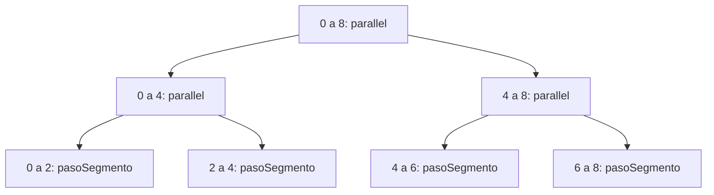

# Informe de paralelización: simulación de partículas

Encargado del informe: Santiago Velandia.

## 1. La estrategia de reparto

El cálculo que se reparte es `pasoParalelo`, un paso de la simulación. La
posición nueva de cada partícula depende solo de esa partícula (`mover`), así
que cualquier tramo del arreglo se puede resolver sin mirar a los demás.

```Scala
def pasoParalelo(s: Sistema, dt: Double, umbral: Int): Sistema = {
  val limite = math.max(umbral, 1)

  def repartir(desde: Int, hasta: Int): Sistema =
    if (hasta - desde <= limite) pasoSegmento(s, dt, desde, hasta)
    else {
      val medio = desde + (hasta - desde) / 2
      val (izquierda, derecha) = parallel(repartir(desde, medio), repartir(medio, hasta))
      izquierda ++ derecha
    }

  repartir(0, s.length)
}
```

- **Dónde se reparte:** en cada llamado de `repartir` cuyo tramo tiene más
  partículas que el umbral. El tramo se parte por la mitad en `medio`.
- **Con qué abstracción:** `parallel` del paquete `common`, que lanza la mitad
  derecha como una tarea del `ForkJoinPool` y resuelve la izquierda en el hilo
  actual.
- **Con qué criterio se deja de partir:** cuando el tramo tiene como máximo
  `umbral` partículas. Ahí se resuelve en secuencial con `pasoSegmento`.
- **Qué combina los resultados parciales:** la concatenación `++`, que es
  asociativa. La mitad izquierda y la derecha cubren los índices
  $[d, m)$ y $[m, h)$, que no se cruzan ni dejan huecos:

```math
[d, m) \cup [m, h) = [d, h)
\qquad
[d, m) \cap [m, h) = \emptyset
```

Las magnitudes globales del punto 3 se reparten con el mismo árbol de llamados.
Lo único que cambia es la operación de combinación: la energía se combina
sumando, y el centro de masa lleva la pareja (suma ponderada de posiciones,
masa) que también se combina sumando, y se divide una sola vez al final.

El árbol para ocho partículas con umbral 2, con las hojas en secuencial:



### Cómo se midió

Los tiempos salen de `App.scala` con ScalaMeter, antes de cada medición se llama a `System.gc()` para que una pausa del recolector no caiga en medio de lo que se mide:
`withWarmer(new Warmer.Default) measure { ... }` ejecuta el bloque hasta que la
máquina virtual se estabiliza y solo entonces mide. Cada cifra es la mediana de
cinco mediciones, en milisegundos. La función `medir` ya venía en el
repositorio.

`pasoSecuencial` es `pasoSegmento(s, dt, 0, s.length)`, y `pasoParalelo` resuelve
cada hoja con el mismo `pasoSegmento`. Así las dos versiones recorren el
arreglo de la misma forma y la diferencia de tiempos es la del reparto, no la de
dos maneras distintas de construir el arreglo.

## 2. La tabla de tiempos

Máquina de la medición: **12 procesadores lógicos**
(`Runtime.getRuntime.availableProcessors`), que son 6 núcleos físicos con dos hilos cada uno
(AMD Ryzen 5 5600H, 3,30 GHz base, caché L3 de 16 MB), 16 GB de RAM DDR4 a 3200 MT/s, Java 17.
Se cerraron los demás programas y se hicieron **dos corridas completas**
(medición 1 y medición 2) para ver cuánto se mueven los números de una a otra.
Los sistemas tienen $n$ partículas con posiciones, velocidades y masas que
dependen del índice, y `dt = 0,5`. Los tiempos están en milisegundos y cada uno
es la mediana de cinco mediciones de ScalaMeter.

La columna «Estimada» es el trabajo total dividido entre el tiempo estimado del
punto 4 con $p = 12$:

```math
\text{estimada} = \frac{\text{trabajo}(n)}{\text{tiempoEstimado}(n, 12, u)}
```

La primera fila de cada tabla, con el umbral igual al tamaño del sistema, es la
**fila de control**: no reparte nada y su aceleración tiene que dar 1. El número
de particiones es cuántas veces se parte el sistema a la mitad hasta llegar al
umbral.

### $n = 1\,000\,000$ (secuencial: 29,9 ms en la medición 1 y 30,6 ms en la 2)

| Umbral | Particiones | Paralela 1 | Aceleración 1 | Paralela 2 | Aceleración 2 | Estimada |
|---:|---:|---:|---:|---:|---:|---:|
| 1 000 000 (control) | 0 | 23,7 | 1,26 | 22,4 | 1,37 | 0,92 |
| 500 000 | 1 | 12,6 | 2,37 | 15,9 | 1,93 | 1,71 |
| 125 000 | 3 | 16,0 | 1,87 | 15,2 | 2,02 | 4,80 |
| 100 000 | 4 | 14,6 | 2,05 | 15,1 | 2,02 | 6,86 |
| 10 000 | 7 | 69,9 | 0,43 | 15,8 | 1,94 | 10,97 |
| 1 000 | 10 | 63,2 | 0,47 | 17,5 | 1,75 | 11,86 |

### $n = 2\,000\,000$ (secuencial: 75,4 ms en la medición 1 y 52,8 ms en la 2)

| Umbral | Particiones | Paralela 1 | Aceleración 1 | Paralela 2 | Aceleración 2 | Estimada |
|---:|---:|---:|---:|---:|---:|---:|
| 2 000 000 (control) | 0 | 69,9 | 1,08 | 47,3 | 1,12 | 0,92 |
| 1 000 000 | 1 | 73,9 | 1,02 | 133,2 | 0,40 | 1,71 |
| 250 000 | 3 | 126,7 | 0,60 | 136,6 | 0,39 | 4,80 |
| 100 000 | 5 | 153,8 | 0,49 | 141,8 | 0,37 | 8,73 |
| 10 000 | 8 | 150,0 | 0,50 | 143,0 | 0,37 | 11,46 |
| 1 000 | 11 | 128,9 | 0,58 | 137,4 | 0,38 | 11,93 |

### $n = 3\,000\,000$ (secuencial: 230,3 ms en la medición 1 y 208,7 ms en la 2)

| Umbral | Particiones | Paralela 1 | Aceleración 1 | Paralela 2 | Aceleración 2 | Estimada |
|---:|---:|---:|---:|---:|---:|---:|
| 3 000 000 (control) | 0 | 195,7 | 1,18 | 203,6 | 1,03 | 0,92 |
| 1 500 000 | 1 | 141,3 | 1,63 | 151,6 | 1,38 | 1,71 |
| 375 000 | 3 | 149,8 | 1,54 | 120,9 | 1,73 | 4,80 |
| 100 000 | 5 | 156,1 | 1,48 | 190,8 | 1,09 | 8,73 |
| 10 000 | 9 | 154,5 | 1,49 | 178,7 | 1,17 | 11,72 |
| 1 000 | 12 | 137,0 | 1,68 | 130,8 | 1,60 | 11,96 |

Resumen de lo que escogió cada herramienta:

| n | Mejor umbral de la tabla (1 / 2) | `umbralConveniente` (1 / 2) | Mejor aceleración (1 / 2) |
|---:|---:|---:|---:|
| 1 000 000 | 500 000 / 100 000 | 125 000 / 500 000 | 2,37 / 2,02 |
| 2 000 000 | 2 000 000 / 2 000 000 | 2 000 000 / 1 000 000 | 1,08 / 1,12 |
| 3 000 000 | 1 000 / 375 000 | 1 500 000 / 375 000 | 1,68 / 1,73 |

## 3. Comparación con la estimación del punto 4

**En qué se parecen.** En el umbral $n/2$ la estimación da 1,71 y la medición dio
entre 1,02 y 2,37 según el tamaño y la corrida, el mismo orden de magnitud.
Tanto la estimación como el reloj muestran que pasar de ninguna partición a una
o tres mejora la aceleración en los sistemas de uno y tres millones.

**En qué no.** La estimación sube hasta casi 12 a medida que el umbral baja,
porque cada partición solo suma una unidad a la profundidad y el trabajo entre
$p$ domina. La medición nunca pasó de 2,4 y, al bajar el umbral, no mejora:
se queda en torno a 1,5 a 2 con $n = 1\,000\,000$ y $n = 3\,000\,000$, y con
$n = 2\,000\,000$ quedó por debajo de 1 en casi todas las filas con reparto.

**A qué se atribuye.** La estimación cuenta operaciones y supone que los 12
procesadores están siempre ocupados y que crear una tarea no cuesta nada. El
reloj incluye cosas que esa cuenta no tiene. Son las explicaciones que
consideramos más probables; no las aislamos con una medición propia:

- **El cálculo de cada partícula es muy pequeño.** `mover` hace unas pocas
  sumas y multiplicaciones, y lo que más cuesta es crear tres objetos nuevos
  por partícula. El trabajo está limitado por la memoria y no por el
  procesador, y 12 procesadores no multiplican el ancho de banda de memoria.
- **Combinar los resultados.** Cada `izquierda ++ derecha` copia las dos
  mitades en un arreglo nuevo. La concatenación de la raíz copia las $n$
  partículas en un solo hilo: es trabajo en serie que la versión secuencial
  no tiene.
- **El recolector de basura.** Cada paso crea cientos de megabytes de objetos
  nuevos y el recolector pausa la ejecución. Es la fuente más probable de que
  los números cambien tanto de una corrida a otra.
- **Procesadores lógicos.** Los 12 que reporta la máquina son 6 núcleos físicos
  con dos hilos cada uno, así que no rinden como 12 núcleos independientes. Con
  6 núcleos, la aceleración máxima que permitiría un cálculo sin parte serial
  es cercana a 6, y la estimación del punto 4 (con $p = 12$) la sobrestima.
- **Memoria disponible.** Durante las corridas el computador tenía en uso unos
  10 GB de sus 16 GB, y con 4 GB libres el recolector de basura tiene poco
  margen para los cientos de megabytes que crea cada paso.

La estimación sirve como techo y para comparar umbrales entre sí, no como
pronóstico del reloj.

## 4. Lectura de los resultados

**Qué tan confiable es la medición.** La fila de control debería dar 1, y dio
entre 1,03 y 1,37 en las seis mediciones. Las dos versiones ejecutan el mismo
código en esa fila (`pasoSegmento(s, dt, 0, n)`), así que esa diferencia es
ruido, y marca el error con que hay que leer la tabla: las diferencias de unas
3 décimas entre filas no significan nada. Dos corridas del mismo programa
también dieron cifras muy distintas en algunas filas; por ejemplo,
$n = 2\,000\,000$ con umbral 1 000 000 dio 1,02 y 0,40, y $n = 1\,000\,000$ con
umbral 10 000 dio 0,43 y 1,94. Por eso se reportan las dos corridas completas
y no solo la mejor.

**Cuándo paga repartir.** Con un millón y con tres millones de partículas hubo
ganancia en la mayoría de los umbrales: entre 1,75 y 2,4 con un millón de
partículas (salvo dos filas de la corrida 1, con 0,43 y 0,47) y entre 1,1 y 1,7 con tres millones. Con dos millones la
versión repartida fue igual o peor que la secuencial en las dos corridas, lo
que no tiene una explicación en el tamaño y que atribuimos a la presión del
recolector en esas corridas.

**Qué umbral conviene.** Los umbrales con pocas particiones, de $n/2$ a $n/8$
(entre 1 y 3 particiones, de 2 a 8 tareas), estuvieron entre los mejores en
$n = 1\,000\,000$ y $n = 3\,000\,000$ en las dos corridas. Bajar el umbral
a 10 000 o 1 000 no mejoró de forma consistente: cada partición agrega llamados a
`parallel` y una copia más al concatenar, y ese costo no se recupera con
tramos tan pequeños. `umbralConveniente` y el mejor de la tabla no siempre
coincidieron (por ejemplo, 125 000 frente a 500 000 con un millón en la
corrida 1), porque cada uno mide por separado y las diferencias entre esos
umbrales están dentro del ruido. Por eso no se puede nombrar un umbral
óptimo único; sí se puede decir que conviene uno de pocas particiones, del orden
de $n/8$ a $n/2$.

**Por qué la aceleración deja de crecer.** Si una fracción $f$ del cálculo no se
reparte, con $p$ procesadores la aceleración máxima es, según la ley de Amdahl:

```math
S(p) = \frac{1}{f + \frac{1 - f}{p}}
\qquad\Longrightarrow\qquad
f = \frac{\frac{1}{S} - \frac{1}{p}}{1 - \frac{1}{p}}
\qquad
S(\infty) = \frac{1}{f}
```

Con la mejor aceleración de cada tamaño y $p = 12$, `App` calculó:

| n | Corrida 1: $S$ → $f$ | Corrida 2: $S$ → $f$ |
|---:|---:|---:|
| 1 000 000 | 2,37 → 0,369 | 2,02 → 0,448 |
| 3 000 000 | 1,68 → 0,558 | 1,73 → 0,541 |

Se descarta $n = 2\,000\,000$ porque ninguna fila repartida superó 1,12 y ahí
la fórmula (0,89 y 0,92) solo refleja que no hubo ganancia. Para los otros
dos tamaños, entre el 37 % y el 56 % del cálculo no se reparte. Con ese valor
de $f$, el techo $1/f$ está entre 1,8 y 2,7, por muchos procesadores que se
agreguen. Por ejemplo, con $f = 0{,}369$:

| p | 2 | 4 | 6 | 12 | ∞ |
|---|---:|---:|---:|---:|---:|
| Aceleración máxima | 1,46 | 1,90 | 2,11 | 2,37 | 2,71 |

Pasar de 6 a 12 procesadores solo agregaría 0,26, que está dentro del ruido
que se midió. Esa fracción en serie es, en este cálculo, la concatenación final
de los resultados, la creación de las primeras tareas, y el acceso a una
memoria compartida por todos los procesadores. Es una atribución razonable,
pero no la comprobamos con una medición aparte.