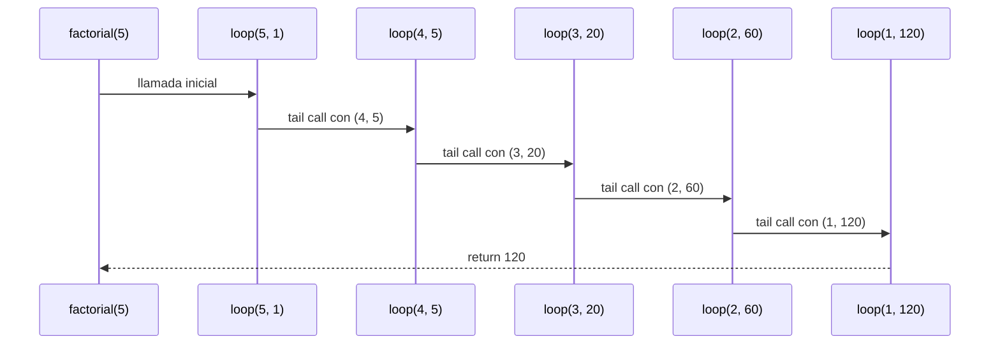
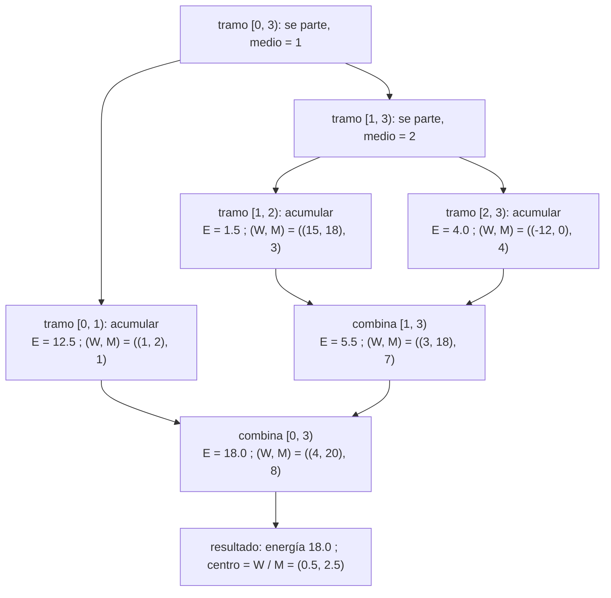

# Algoritmo Factorial con Recursión de Cola

## Definición del Algoritmo

```Scala
def factorial(n: Int): BigInt = {
  @annotation.tailrec
  def loop(x: Int, acumulador: BigInt): BigInt = {
    if (x <= 1) acumulador
    else loop(x - 1, acumulador * x)
  }
  loop(n, 1)
}
```

* La función `factorial` calcula el factorial de un número `n` utilizando **recursión de cola**.
* La función interna `loop` es la que hace la recursión:

  * Recibe dos parámetros:

    * `x`: el valor actual decreciente hasta llegar a 1.
    * `acumulador`: donde se guarda el resultado parcial en cada paso.
* El decorador `@annotation.tailrec` obliga a que la función sea optimizada como recursión de cola, es decir, **no se acumulan llamados en la pila**.

## Explicación paso a paso

### Caso base

```Scala
if (x <= 1) acumulador
```

Cuando `x` llega a `1`, la función retorna directamente el valor acumulado, evitando más llamadas.

### Caso recursivo

```Scala
loop(x - 1, acumulador * x)
```

En cada llamada:

* Se reduce el valor de `x` en 1.
* Se multiplica el acumulador por `x` y se pasa a la siguiente iteración.
* Como es recursión de cola, la llamada recursiva es la **última instrucción** en ejecutarse, lo que permite a Scala optimizar la pila.

---

## Llamados de pila en recursión de cola

Ejemplo:

```Scala
factorial(5)
```

### Paso 1: Llamada inicial

```Scala
loop(5, 1)
```

### Paso 2: Primera iteración

```Scala
loop(4, 5)   // acumulador = 1 * 5
```

### Paso 3: Segunda iteración

```Scala
loop(3, 20)  // acumulador = 5 * 4
```

### Paso 4: Tercera iteración

```Scala
loop(2, 60)  // acumulador = 20 * 3
```

### Paso 5: Cuarta iteración

```Scala
loop(1, 120) // acumulador = 60 * 2
```

### Paso 6: Caso base

```Scala
return 120
```

---

## Diferencia con recursión normal

* En **recursión normal** cada llamada queda en la pila esperando a que termine la siguiente, lo que puede causar desbordamiento si `n` es muy grande.
* En **recursión de cola**, el compilador transforma el proceso en un **bucle optimizado**, por lo que no se guarda cada llamada en la pila y el algoritmo puede ejecutarse para valores muy grandes sin problema.

---

## Ejemplo de uso

```Scala
val resultado = factorial(5)
println(resultado)  // 120
```

El resultado de `factorial(5)` es `120`.


## Diagrama de llamados de pila con recursión de cola




// PARTICIPANTE 1


// PARTICIPANTE 2


// PARTICIPANTE 3
## Punto 3: magnitudes globales en paralelo (energiaParalela y centroDeMasaParalelo)

Las dos funciones reparten el sistema con parallel igual que pasoParalelo: un tramo $[desde, hasta)$ se parte por la mitad mientras tenga más elementos que el umbral (y más de uno, para que con umbral $\le 0$ la recursión termine). Cuando el tramo ya no se parte, un acumular de cola lo recorre por índice y devuelve su resultado parcial. Después cada nivel combina los dos resultados parciales.

| Función | Resultado parcial de un tramo | Cómo se combinan dos tramos | Paso final |
|---|---|---|---|
| energiaParalela | $E = \sum \tfrac{1}{2} m_i \lVert v_i \rVert^2$ | $E_{izq} + E_{der}$ | ninguno |
| centroDeMasaParalelo | pareja $(W, M)$ con $W = \sum m_i\, p_i$ y $M = \sum m_i$ | $(W_{izq} + W_{der},\; M_{izq} + M_{der})$ | $W / M$, una sola vez; origen si $M = 0$ |

### Ejemplo pequeño

Sistema de tres partículas y umbral = 1:

| i | pos | vel | masa | $\tfrac{1}{2} m \lVert v \rVert^2$ | $m \cdot pos$ |
|---|---|---|---|---|---|
| 0 | $(1, 2)$ | $(3, 4)$ | $1$ | $12.5$ | $(1, 2)$ |
| 1 | $(5, 6)$ | $(0, 1)$ | $3$ | $1.5$ | $(15, 18)$ |
| 2 | $(-3, 0)$ | $(-1, -1)$ | $4$ | $4.0$ | $(-12, 0)$ |

**Traza de energiaParalela(s, 1)**

1. energiaTramo(0, 3): el tramo tiene 3 elementos, $3 > 1$, entonces medio = 0 + 3/2 = 1 y se llama parallel(energiaTramo(0, 1), energiaTramo(1, 3)).
2. energiaTramo(0, 1): tiene 1 elemento, no se parte; acumular suma la partícula 0 y devuelve $12.5$.
3. energiaTramo(1, 3): tiene 2 elementos, $2 > 1$, entonces medio = 1 + 2/2 = 2 y se llama parallel(energiaTramo(1, 2), energiaTramo(2, 3)), que devuelven $1.5$ y $4.0$. Se combinan: $1.5 + 4.0 = 5.5$.
4. De vuelta en el primer llamado: $12.5 + 5.5 = 18.0$.
   **Traza de centroDeMasaParalelo(s, 1)**: los tramos son los mismos, pero cada uno devuelve la pareja $(W, M)$.

1. parcial(0, 1) $= ((1, 2),\ 1)$.
2. parcial(1, 2) $= ((15, 18),\ 3)$ y parcial(2, 3) $= ((-12, 0),\ 4)$; combinados, parcial(1, 3) $= ((3, 18),\ 7)$.
3. parcial(0, 3) $= ((1, 2) + (3, 18),\ 1 + 7) = ((4, 20),\ 8)$.
4. Se divide una sola vez: $(4, 20) / 8 = (0.5,\ 2.5)$.
   Si en cambio se promediaran los centros de cada mitad, se obtendría $\tfrac{1}{2}\big((1, 2) + (\tfrac{3}{7}, \tfrac{18}{7})\big) = (\tfrac{5}{7}, \tfrac{16}{7}) \approx (0.71,\ 2.29)$, que no es el centro de masa $(0.5,\ 2.5)$: las dos mitades no pesan igual.

### Diagrama de los llamados



### Casos especiales

- **Sistema vacío:** energiaTramo(0, 0) no se parte y acumular devuelve $0.0$. En el centro de masa, $M = 0$ y se devuelve el origen.
- **umbral $\le 0$ o mayor que el sistema:** con $umbral \le 0$ el tramo se parte hasta quedar de un elemento (la condición $hasta - desde > 1$ detiene la recursión); con un umbral mayor o ig


// PARTICIPANTE 4