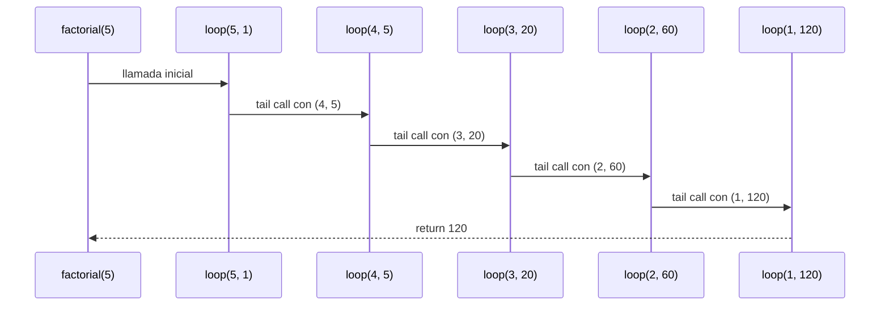

# Algoritmo Factorial con Recursión de Cola

## Definición del Algoritmo

```Scala
def factorial(n: Int): BigInt = {
  @annotation.tailrec
  def loop(x: Int, acumulador: BigInt): BigInt = {
    if (x <= 1) acumulador
    else loop(x - 1, acumulador * x)
  }
  loop(n, 1)
}
```

* La función `factorial` calcula el factorial de un número `n` utilizando **recursión de cola**.
* La función interna `loop` es la que hace la recursión:

  * Recibe dos parámetros:

    * `x`: el valor actual decreciente hasta llegar a 1.
    * `acumulador`: donde se guarda el resultado parcial en cada paso.
* El decorador `@annotation.tailrec` obliga a que la función sea optimizada como recursión de cola, es decir, **no se acumulan llamados en la pila**.

## Explicación paso a paso

### Caso base

```Scala
if (x <= 1) acumulador
```

Cuando `x` llega a `1`, la función retorna directamente el valor acumulado, evitando más llamadas.

### Caso recursivo

```Scala
loop(x - 1, acumulador * x)
```

En cada llamada:

* Se reduce el valor de `x` en 1.
* Se multiplica el acumulador por `x` y se pasa a la siguiente iteración.
* Como es recursión de cola, la llamada recursiva es la **última instrucción** en ejecutarse, lo que permite a Scala optimizar la pila.

---

## Llamados de pila en recursión de cola

Ejemplo:

```Scala
factorial(5)
```

### Paso 1: Llamada inicial

```Scala
loop(5, 1)
```

### Paso 2: Primera iteración

```Scala
loop(4, 5)   // acumulador = 1 * 5
```

### Paso 3: Segunda iteración

```Scala
loop(3, 20)  // acumulador = 5 * 4
```

### Paso 4: Tercera iteración

```Scala
loop(2, 60)  // acumulador = 20 * 3
```

### Paso 5: Cuarta iteración

```Scala
loop(1, 120) // acumulador = 60 * 2
```

### Paso 6: Caso base

```Scala
return 120
```

---

## Diferencia con recursión normal

* En **recursión normal** cada llamada queda en la pila esperando a que termine la siguiente, lo que puede causar desbordamiento si `n` es muy grande.
* En **recursión de cola**, el compilador transforma el proceso en un **bucle optimizado**, por lo que no se guarda cada llamada en la pila y el algoritmo puede ejecutarse para valores muy grandes sin problema.

---

## Ejemplo de uso

```Scala
val resultado = factorial(5)
println(resultado)  // 120
```

El resultado de `factorial(5)` es `120`.


## Diagrama de llamados de pila con recursión de cola




// PUNTO 1


// PUNTO 2


// PUNTO 3


// PUNTO 4


// PUNTO 5
# Informe de proceso — Punto 5: medición de la aceleración

**Asignatura:** Fundamentos de Programación Funcional y Concurrente  
**Proyecto:** Simulación de partículas  
**Punto:** 5 — Medición de la aceleración

## 1. Objetivo

El punto 5 compara el tiempo de `pasoSecuencial` con el de `pasoParalelo` para sistemas grandes. También permite observar cómo influye el umbral en la división del arreglo y seleccionar el umbral que obtuvo el menor tiempo.

La aceleración se calcula como:

\[
A = \frac{T_s}{T_p}
\]

donde \(T_s\) es el tiempo secuencial y \(T_p\) el tiempo paralelo. Si \(A>1\), la medición paralela fue más rápida; si \(A<1\), fue más lenta.

## 2. Preparación del sistema

Se generaron arreglos de 1.000.000, 2.000.000 y 3.000.000 de partículas. Cada partícula se construyó a partir de su índice, con posición, velocidad y masa determinadas de forma reproducible. Se utilizó `dt = 0.5`.

El programa detectó 12 procesadores lógicos mediante `Runtime.getRuntime.availableProcessors`.

## 3. Equipo utilizado

| Componente | Especificación |
|---|---|
| Procesador | AMD Ryzen 5 5600H with Radeon Graphics, 3,30 GHz |
| Núcleos físicos | 6 |
| Hilos / procesadores lógicos | 12 |
| Memoria RAM | 16 GB instalados (13,9 GB utilizables) |
| Gráficos | AMD Radeon integrada (2 GB reportados por Windows) |
| Sistema | Windows de 64 bits, arquitectura x64 |

La simulación es un cálculo de CPU; la GPU integrada no interviene en el reparto de tareas descrito en este informe. El identificador del dispositivo y el identificador del producto de Windows se omiten porque no aportan información técnica necesaria para reproducir las mediciones.

## 4. Procedimiento de medición

1. Se construyó el arreglo de partículas para el tamaño solicitado.
2. Se midió `pasoSecuencial` con ScalaMeter.
3. Se midió el caso de control: `pasoParalelo` con umbral igual a `n`. Este umbral evita dividir el arreglo y debe producir una aceleración cercana a 1.
4. Se midió `pasoParalelo` con los demás umbrales candidatos.
5. Para cada tiempo se tomó la mediana de cinco mediciones de ScalaMeter, utilizando `withWarmer(new Warmer.Default) measure`.
6. Se calculó la aceleración como el cociente entre el tiempo secuencial y el paralelo.
7. Se identificó el mayor valor de aceleración de la tabla y se ejecutó `umbralConveniente`, que vuelve a medir los candidatos para escoger el de menor tiempo.

Los umbrales se generan con `List(n, n / 2, n / 8, 100000, 10000, 1000).distinct`. La columna «Particiones» indica cuántas divisiones recursivas por la mitad se realizan antes de llegar al tamaño del umbral; no representa el número de procesadores.

## 5. Traza de ejecución de la división

Como ejemplo pequeño, considérese un sistema de 8 partículas y un umbral de 2. La llamada inicial es `repartir(0, 8)`:

```text
repartir(0, 8)
├── repartir(0, 4)
│   ├── repartir(0, 2)  → pasoSegmento(s, dt, 0, 2)
│   └── repartir(2, 4)  → pasoSegmento(s, dt, 2, 4)
│   → combina los resultados [0,2) y [2,4)
└── repartir(4, 8)
    ├── repartir(4, 6)  → pasoSegmento(s, dt, 4, 6)
    └── repartir(6, 8)  → pasoSegmento(s, dt, 6, 8)
    → combina los resultados [4,6) y [6,8)
→ combina los resultados de [0,4) y [4,8)
```

En cada división, `parallel` recibe las llamadas de los dos segmentos. Cuando el tamaño de un segmento es menor o igual al umbral, deja de dividirse y se procesa con `pasoSegmento`. Los arreglos parciales se concatenan en el mismo orden mediante `izquierda ++ derecha`.

## 6. Resultados observados

Los siguientes valores corresponden a la última ejecución compartida. Los tiempos están expresados en milisegundos. La aceleración estimada corresponde al modelo del punto 4 y no a una medición.

### Sistema de 1.000.000 de partículas

Tiempo secuencial: **26,9 ms**.

| Umbral | Particiones | Paralela (ms) | Aceleración medida | Aceleración estimada |
|---:|---:|---:|---:|---:|
| 1.000.000 (control) | 0 | 51,3 | 0,52 | 0,92 |
| 500.000 | 1 | 17,9 | 1,50 | 1,71 |
| 125.000 | 3 | 78,1 | 0,34 | 4,80 |
| 100.000 | 4 | 74,7 | 0,36 | 6,86 |
| 10.000 | 7 | 71,4 | 0,38 | 10,97 |
| 1.000 | 10 | 86,1 | 0,31 | 11,86 |

El mejor resultado de la tabla fue el umbral **500.000**, con aceleración observada de **1,50**. `umbralConveniente` también seleccionó 500.000.

### Sistema de 2.000.000 de partículas

Tiempo secuencial: **127,4 ms**.

| Umbral | Particiones | Paralela (ms) | Aceleración medida | Aceleración estimada |
|---:|---:|---:|---:|---:|
| 2.000.000 (control) | 0 | 130,7 | 0,98 | 0,92 |
| 1.000.000 | 1 | 75,1 | 1,70 | 1,71 |
| 250.000 | 3 | 115,7 | 1,10 | 4,80 |
| 100.000 | 5 | 131,0 | 0,97 | 8,73 |
| 10.000 | 8 | 129,2 | 0,99 | 11,46 |
| 1.000 | 11 | 125,2 | 1,02 | 11,93 |

El mejor resultado de la tabla fue el umbral **1.000.000**, con aceleración observada de **1,70**. `umbralConveniente` también seleccionó 1.000.000.

### Sistema de 3.000.000 de partículas

Tiempo secuencial: **175,2 ms**.

| Umbral | Particiones | Paralela (ms) | Aceleración medida | Aceleración estimada |
|---:|---:|---:|---:|---:|
| 3.000.000 (control) | 0 | 65,5 | 2,68 | 0,92 |
| 1.500.000 | 1 | 128,8 | 1,36 | 1,71 |
| 375.000 | 3 | 141,0 | 1,24 | 4,80 |
| 100.000 | 5 | 194,9 | 0,90 | 8,73 |
| 10.000 | 9 | 158,7 | 1,10 | 11,72 |
| 1.000 | 12 | 157,3 | 1,11 | 11,96 |

El mayor valor de la tabla fue el control sin particiones, con aceleración aparente de **2,68**. `umbralConveniente` también seleccionó 3.000.000. Este resultado no puede interpretarse como una aceleración causada por el paralelismo, porque el control no crea particiones.

## 7. Consideraciones sobre la validez de los datos

La ejecución terminó con `BUILD SUCCESSFUL`, lo que confirma que Gradle compiló y ejecutó la aplicación. No demuestra por sí solo que las mediciones sean estables.

El control debería dar una aceleración cercana a 1 porque no reparte el trabajo. En esta ejecución dio 0,52 para un millón de partículas, 0,98 para dos millones y 2,68 para tres millones. La primera y la tercera diferencias son demasiado grandes para atribuirlas al costo de una condición adicional o a la paralelización. Sugieren variabilidad de la medición, por ejemplo por calentamiento de la JVM, recolección de basura, presión de memoria, carga del sistema u otros efectos del entorno.

Por ello, las tablas documentan los valores efectivamente observados, pero no permiten afirmar de manera concluyente que esos sean los mejores umbrales reales ni que la aceleración aparente del control sea una ganancia de rendimiento. La estimación de Amdahl también debe considerarse provisional.
