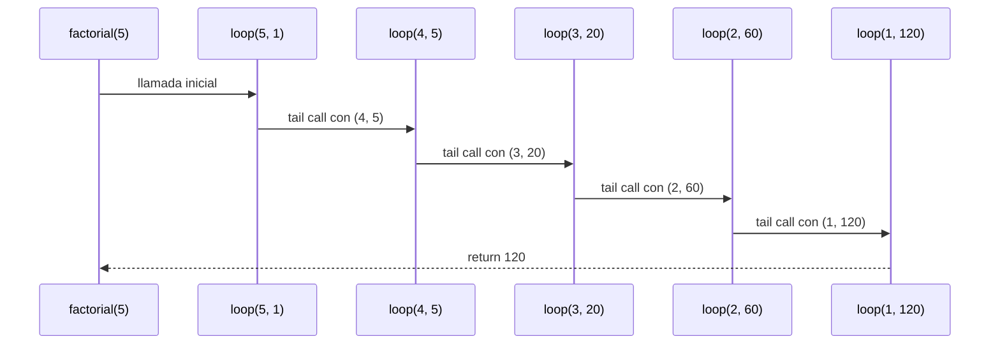
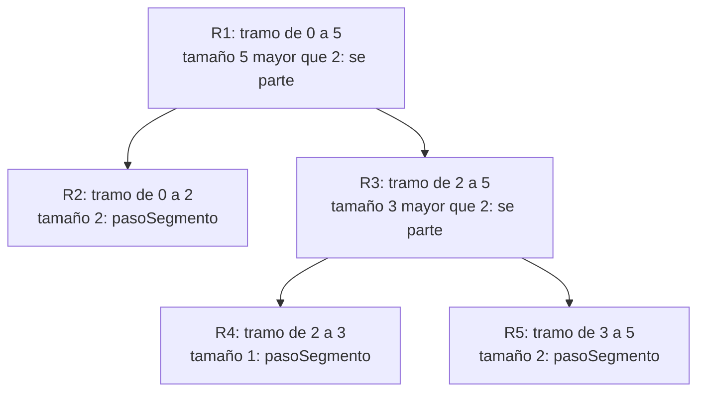
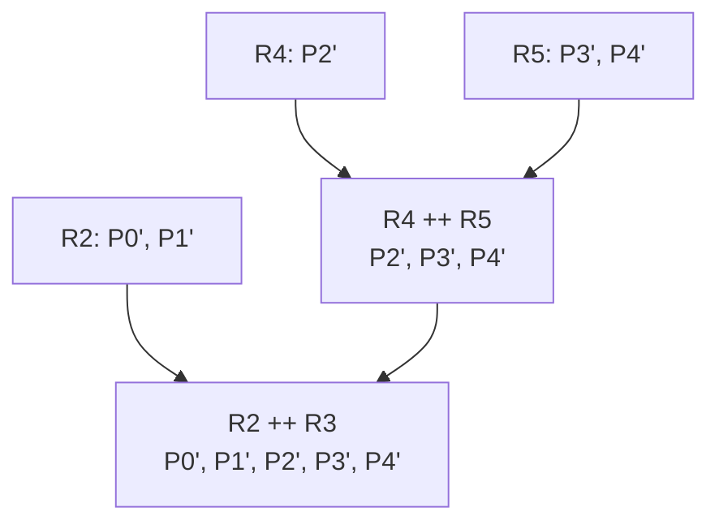
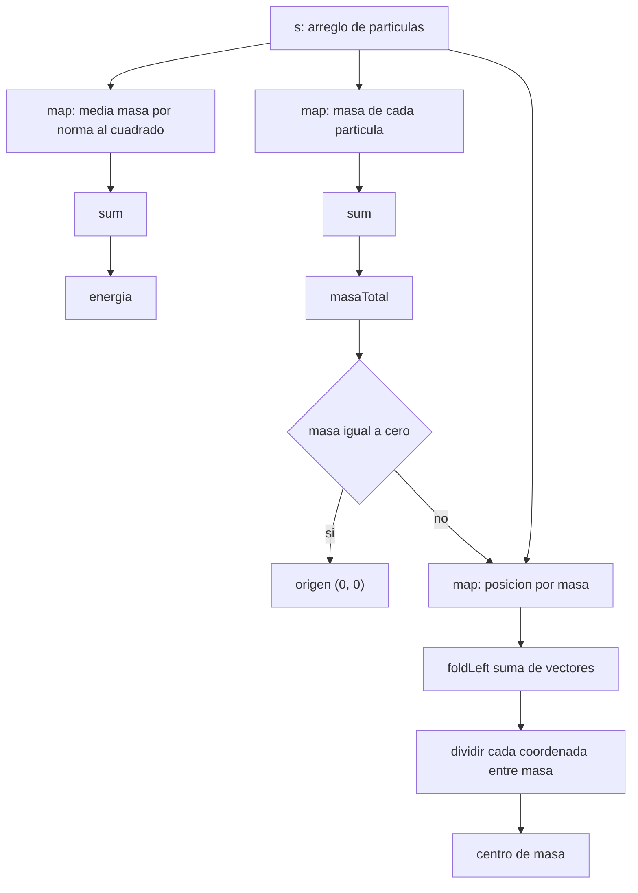
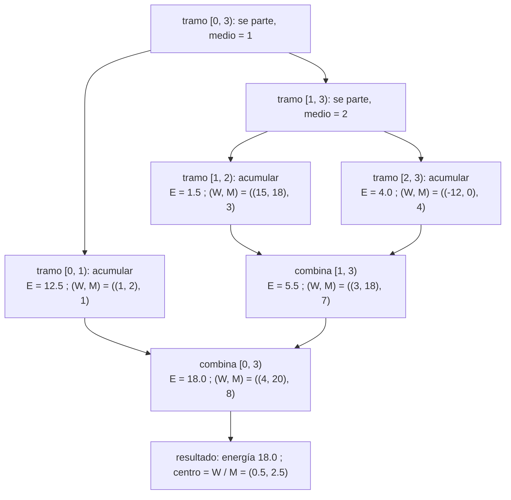
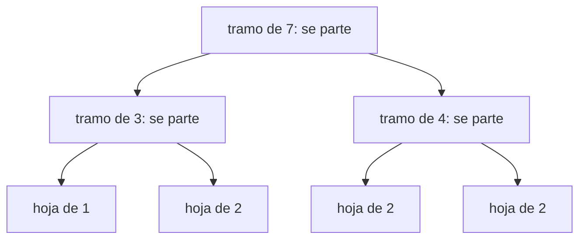
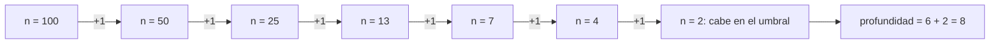
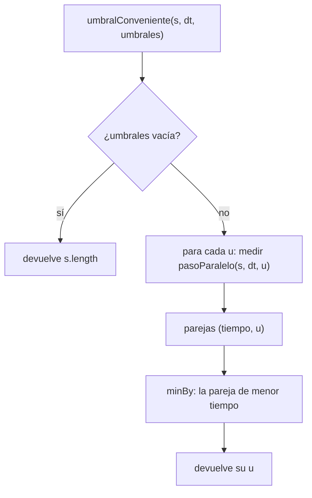

# Algoritmo Factorial con Recursión de Cola

## Definición del Algoritmo

```Scala
def factorial(n: Int): BigInt = {
  @annotation.tailrec
  def loop(x: Int, acumulador: BigInt): BigInt = {
    if (x <= 1) acumulador
    else loop(x - 1, acumulador * x)
  }
  loop(n, 1)
}
```

* La función `factorial` calcula el factorial de un número `n` utilizando **recursión de cola**.
* La función interna `loop` es la que hace la recursión:

  * Recibe dos parámetros:

    * `x`: el valor actual decreciente hasta llegar a 1.
    * `acumulador`: donde se guarda el resultado parcial en cada paso.
* El decorador `@annotation.tailrec` obliga a que la función sea optimizada como recursión de cola, es decir, **no se acumulan llamados en la pila**.

## Explicación paso a paso

### Caso base

```Scala
if (x <= 1) acumulador
```

Cuando `x` llega a `1`, la función retorna directamente el valor acumulado, evitando más llamadas.

### Caso recursivo

```Scala
loop(x - 1, acumulador * x)
```

En cada llamada:

* Se reduce el valor de `x` en 1.
* Se multiplica el acumulador por `x` y se pasa a la siguiente iteración.
* Como es recursión de cola, la llamada recursiva es la **última instrucción** en ejecutarse, lo que permite a Scala optimizar la pila.

---

## Llamados de pila en recursión de cola

Ejemplo:

```Scala
factorial(5)
```

### Paso 1: Llamada inicial

```Scala
loop(5, 1)
```

### Paso 2: Primera iteración

```Scala
loop(4, 5)   // acumulador = 1 * 5
```

### Paso 3: Segunda iteración

```Scala
loop(3, 20)  // acumulador = 5 * 4
```

### Paso 4: Tercera iteración

```Scala
loop(2, 60)  // acumulador = 20 * 3
```

### Paso 5: Cuarta iteración

```Scala
loop(1, 120) // acumulador = 60 * 2
```

### Paso 6: Caso base

```Scala
return 120
```

---

## Diferencia con recursión normal

* En **recursión normal** cada llamada queda en la pila esperando a que termine la siguiente, lo que puede causar desbordamiento si `n` es muy grande.
* En **recursión de cola**, el compilador transforma el proceso en un **bucle optimizado**, por lo que no se guarda cada llamada en la pila y el algoritmo puede ejecutarse para valores muy grandes sin problema.

---

## Ejemplo de uso

```Scala
val resultado = factorial(5)
println(resultado)  // 120
```

El resultado de `factorial(5)` es `120`.


## Diagrama de llamados de pila con recursión de cola




// PUNTO 1
## Punto 1: un paso de la simulación

Un paso de la simulación hace una sola cosa: cada partícula se mueve según su velocidad. Su posición nueva es la anterior más la velocidad por el tiempo `dt`, y su velocidad y su masa se quedan como estaban. Lo interesante es que el cálculo de una partícula no depende de ninguna otra, y por eso el trabajo se puede repartir. Son cuatro funciones: `mover` hace el cálculo de una partícula, `pasoSegmento` lo hace para un tramo del arreglo, `pasoSecuencial` lo hace para todo el sistema y `pasoParalelo` parte el sistema en tramos que se calculan al mismo tiempo.

Para las trazas usamos un sistema pequeño de cinco partículas, numeradas desde cero. La partícula `i` está en `(i, 0)`, se mueve con velocidad `(1, 1)` y tiene masa 1. Con `dt = 2.0`, cada una debería terminar en `(i + 2, 2)`.

| i | Posición | Velocidad | Masa |
|---|----------|-----------|------|
| 0 | `(0, 0)` | `(1, 1)` | 1.0 |
| 1 | `(1, 0)` | `(1, 1)` | 1.0 |
| 2 | `(2, 0)` | `(1, 1)` | 1.0 |
| 3 | `(3, 0)` | `(1, 1)` | 1.0 |
| 4 | `(4, 0)` | `(1, 1)` | 1.0 |

### mover

```scala
def mover(p: Particula, dt: Double): Particula =
  Particula(p.pos + p.vel * dt, p.vel, p.masa)
```

Es el cálculo de una sola partícula, y los demás se apoyan en él. Primero multiplica la velocidad por `dt`, después le suma ese desplazamiento a la posición, y arma una partícula nueva con esa posición y con la misma velocidad y la misma masa. No se modifica ninguna partícula: cada llamado devuelve una nueva.

Traza con la partícula 3 y `dt = 2.0`:

| Paso | Operación | Resultado |
|------|-----------|-----------|
| 1 | `p.vel * dt` | `(1, 1) * 2.0 = (2, 2)` |
| 2 | `p.pos + (2, 2)` | `(3, 0) + (2, 2) = (5, 2)` |
| 3 | se arma la partícula nueva | `Particula((5, 2), (1, 1), 1.0)` |

### pasoSegmento

```scala
def pasoSegmento(s: Sistema, dt: Double, desde: Int, hasta: Int): Sistema = {
  val inicio = math.max(desde, 0)
  val fin = math.min(hasta, s.length)
  Array.tabulate(math.max(fin - inicio, 0))(i => mover(s(inicio + i), dt))
}
```

Avanza solo el tramo que empieza en `desde`, incluido, y termina en `hasta`, excluido, y devuelve un arreglo con solo esas partículas ya movidas. Funciona en tres pasos:

1. Recorta el tramo a los límites del arreglo, por si `desde` es negativo o `hasta` se pasa del final.
2. Calcula cuántas partículas tiene el tramo, que es `fin - inicio`, o cero si el tramo quedó vacío o al revés.
3. `Array.tabulate` arma un arreglo de esa longitud, y en la posición `i` pone la partícula `inicio + i` del sistema, ya movida con `mover`.

Traza con `pasoSegmento(s, 2.0, 1, 4)` sobre el sistema de arriba:

| Paso | Qué se calcula | Valor |
|------|----------------|-------|
| 1 | `inicio` y `fin` | `inicio = 1` y `fin = 4`, que están dentro del arreglo |
| 2 | largo del tramo | `4 - 1 = 3` |
| 3 | posición 0 del resultado | `mover(s(1), 2.0)`, que da `(3, 2)` |
| 4 | posición 1 del resultado | `mover(s(2), 2.0)`, que da `(4, 2)` |
| 5 | posición 2 del resultado | `mover(s(3), 2.0)`, que da `(5, 2)` |

El resultado tiene tres partículas, que son la 1, la 2 y la 3 ya movidas. La 0 y la 4 no aparecen porque quedaron fuera del tramo. Con `desde` igual a `hasta`, el largo es cero y el resultado es un arreglo vacío. Con `hasta = 100` sobre este sistema de cinco partículas, el paso 1 lo recorta a 5.

### pasoSecuencial

```scala
def pasoSecuencial(s: Sistema, dt: Double): Sistema =
  pasoSegmento(s, dt, 0, s.length)
```

El paso secuencial es el segmento que cubre todo el sistema, desde la posición 0 hasta el final. Se escribió así a propósito: el enunciado advierte que, si la versión secuencial y la paralela calculan cada tramo de maneras distintas, la diferencia de tiempos mide dos operaciones diferentes y no solo el reparto. Con esta definición, las dos versiones usan exactamente la misma función para calcular cada tramo.

Traza con `pasoSecuencial(s, 2.0)`: es `pasoSegmento(s, 2.0, 0, 5)`, que calcula las cinco partículas y devuelve las posiciones `(2, 2)`, `(3, 2)`, `(4, 2)`, `(5, 2)` y `(6, 2)`, que es lo que esperábamos.

### pasoParalelo

```scala
def pasoParalelo(s: Sistema, dt: Double, umbral: Int): Sistema = {
  val limite = math.max(umbral, 1)
  // Si todo el sistema cabe en el umbral no se reparte nada: se resuelve igual
  // que la versión secuencial.
  if (s.length <= limite) {
    pasoSegmento(s, dt, 0, s.length)
  } else {
    def repartir(desde: Int, hasta: Int): Sistema =
      if (hasta - desde <= limite) pasoSegmento(s, dt, desde, hasta)
      else {
        val medio = desde + (hasta - desde) / 2
        val (izquierda, derecha) =
          parallel(repartir(desde, medio), repartir(medio, hasta))
        izquierda ++ derecha
      }

    repartir(0, s.length)
  }
}
```

Esta función tiene cuatro partes.

La primera es `limite`, que es el umbral pero nunca menor que uno. Si el umbral fuera cero, un tramo de un solo elemento se seguiría partiendo para siempre, porque su mitad izquierda quedaría vacía y su mitad derecha sería ese mismo tramo.

La segunda es una revisión inicial: si todo el sistema cabe en el umbral, es decir, si `s.length` no pasa de `limite`, no hay nada que repartir y se calcula de una vez con `pasoSegmento(s, dt, 0, s.length)`, que es justo lo que hace `pasoSecuencial`. Esta revisión no cambia lo que se calcula, porque si se saltara, el primer llamado de `repartir` caería en su caso base y haría esa misma llamada. Lo que hace es dejar explícito el caso en que no se reparte nada, que es el caso de control de las mediciones.

La tercera es la función interna `repartir`, que solo se define cuando el sistema sí pasa del umbral. Trabaja sobre el tramo que va de `desde` a `hasta`, y tiene dos casos:

* Si el tramo no pasa del umbral, se calcula directamente con `pasoSegmento`. Es el caso base: ahí no se reparte nada.
* Si el tramo pasa del umbral, se calcula el punto medio, `desde + (hasta - desde) / 2`, y se parten dos tramos: de `desde` a `medio` y de `medio` a `hasta`. Con `parallel`, la mitad derecha se entrega como una tarea para que la haga otro hilo, mientras el hilo que llama se ocupa de la izquierda. Cuando las dos terminan, se pegan con `izquierda ++ derecha`.

La cuarta es la llamada inicial, `repartir(0, s.length)`, que arranca con el sistema completo.

La división del medio se escribe como `desde + (hasta - desde) / 2` y no como `(desde + hasta) / 2` para que la suma no se pase del límite de un entero cuando el arreglo es muy grande. Cuando el tramo tiene tamaño impar, la mitad izquierda se queda con el piso de la mitad y la derecha con el resto, por ejemplo 2 y 3 para un tramo de 5.

Traza con el sistema de cinco partículas, `dt = 2.0` y `umbral = 2`. Cada fila es un llamado a `repartir`:

| Llamado | Tramo | Tamaño | ¿Pasa del umbral (2)? | Qué hace |
|---------|-------|--------|-----------------------|----------|
| R1 | de 0 a 5 | 5 | sí | `medio = 0 + 5/2 = 2`: parte en los tramos de 0 a 2 y de 2 a 5 |
| R2 | de 0 a 2 | 2 | no | resuelve con `pasoSegmento` y devuelve P0 y P1 ya movidas |
| R3 | de 2 a 5 | 3 | sí | `medio = 2 + 3/2 = 3`: parte en los tramos de 2 a 3 y de 3 a 5 |
| R4 | de 2 a 3 | 1 | no | resuelve con `pasoSegmento` y devuelve P2 ya movida |
| R5 | de 3 a 5 | 2 | no | resuelve con `pasoSegmento` y devuelve P3 y P4 ya movidas |

Aquí `Pi` es la partícula `i` y `Pi'` es la misma partícula ya movida, que queda en `(i + 2, 2)`. Estos tramos no son una suposición: los registramos ejecutando la función real y quedaron exactamente así.



Las hojas del árbol son R2, R4 y R5, y son los llamados que de verdad calculan partículas. Sus tramos, de 0 a 2, de 2 a 3 y de 3 a 5, tienen 2, 1 y 2 partículas, que suman las 5 del sistema, y ninguna aparece en dos hojas. Esto es justo lo que se demuestra en el informe de corrección.

El reparto se hace hacia abajo, partiendo el tramo. Los resultados se combinan hacia arriba, y en ese orden:

| Paso | Qué se une | Resultado |
|------|------------|-----------|
| 1 | R4 y R5, con `++` | `P2', P3', P4'`, que es el resultado del tramo de 2 a 5 |
| 2 | R2 y el resultado del paso 1, con `++` | `P0', P1', P2', P3', P4'` |

Con las posiciones, el resultado final es `(2, 2)`, `(3, 2)`, `(4, 2)`, `(5, 2)` y `(6, 2)`, igual que el de `pasoSecuencial`.



Lo que importa de la unión es el orden: siempre va la izquierda antes que la derecha. Si en algún `++` se invirtieran, las partículas quedarían en posiciones cambiadas, aunque ninguna se perdiera.

Cómo cambia el reparto con el umbral, para un sistema de cinco y de siete partículas. Los tramos son los de las hojas del árbol, registrados al ejecutar la función real:

| Partículas | Umbral | Tramos que se calculan directamente |
|------------|--------|--------------------------------------|
| 5 | 1 | de 0 a 1, de 1 a 2, de 2 a 3, de 3 a 4, de 4 a 5 (cinco tramos) |
| 5 | 2 | de 0 a 2, de 2 a 3, de 3 a 5 (tres tramos) |
| 5 | 5 o más | de 0 a 5 (un solo tramo: no se reparte nada) |
| 7 | 2 | de 0 a 1, de 1 a 3, de 3 a 5, de 5 a 7 (cuatro tramos) |
| 5 | 0 | igual que con umbral 1, porque el umbral nunca baja de uno |

Con un umbral que cubre todo el sistema, que es el caso de control que pide el enunciado, la revisión inicial lo detecta y la función nunca se parte: calcula directamente el tramo de 0 a `n`, que es exactamente lo que hace `pasoSecuencial`. Por eso en ese caso las dos versiones hacen el mismo trabajo, y la aceleración medida tiene que dar 1.

Una última observación: cada vez que se parte un tramo se lanza una tarea nueva para su mitad derecha, y cada `++` copia los elementos de las dos mitades en un arreglo nuevo. Mientras más pequeño es el umbral, más tareas se lanzan y más veces se copian los datos. Ese costo del reparto es el que el informe de paralelización compara contra lo que se ahorra.


## Punto 2: magnitudes globales (energiaSecuencial, masaTotal y centroDeMasaSecuencial)

```scala
def energiaSecuencial(s: Sistema): Double = {
  val energias = s.map(particula => 0.5 * particula.masa * particula.vel.norma * particula.vel.norma)
  energias.sum
}

def masaTotal(s: Sistema): Double = {
  val masas = s.map(particula => particula.masa)
  masas.sum
}

def centroDeMasaSecuencial(s: Sistema): Vector2 = {
  val masa = masaTotal(s)
  if (masa == 0.0) Vector2(0.0, 0.0)
  else {
    val ponderadas = s.map(particula => particula.pos * particula.masa)
    val suma = ponderadas.foldLeft(Vector2(0.0, 0.0))((acumulado, v) => acumulado + v)
    Vector2(suma.x / masa, suma.y / masa)
  }
}
```

Estas tres funciones recorren el sistema completo, sin repartirlo: son la
versión secuencial con la que se compara el Punto 3. No se usó ninguna
expresión `for`; los recorridos se hacen con `map`, `sum` y `foldLeft`. No hay
`var`, `while` ni `return`.

### Qué hace cada operación

* `s.map(particula => ...)` recorre el arreglo y convierte cada partícula en
  otro valor. Devuelve un arreglo nuevo del mismo largo, y el original no se
  modifica.
* `particula.vel.norma` es el largo del vector velocidad, `sqrt(x*x + y*y)`.
  La energía de una partícula es `0.5 * masa * norma * norma`.
* `energias.sum` y `masas.sum` suman todos los números del arreglo. Con un
  arreglo vacío dan `0.0`.
* `particula.pos * particula.masa` multiplica las dos coordenadas de la
  posición por la masa: es la posición "ponderada".
* `foldLeft(Vector2(0.0, 0.0))((acumulado, v) => acumulado + v)` suma los
  vectores de izquierda a derecha. Empieza con el vector `(0, 0)`, y en cada paso
  suma el siguiente vector al acumulado.
* `if (masa == 0.0) Vector2(0.0, 0.0)` evita dividir entre cero: sin masa, el
  centro es el origen, como pide el enunciado.
* `val` le pone un nombre a un resultado. Se fija una vez y no cambia, así que
  no es una variable.

### Ejemplo pequeño

Sistema de dos partículas:

| Partícula | `pos` | `vel` | `masa` |
|---|---|---|:---:|
| P0 | (0, 0) | (3, 4) | 2.0 |
| P1 | (4, 0) | (0, 0) | 2.0 |

**Traza de `energiaSecuencial(s)`**

1. `s.map(...)` calcula la energía de cada partícula:
   * P0: `norma` de (3, 4) es 5.0, y `0.5 * 2.0 * 5.0 * 5.0 = 25.0`.
   * P1: `norma` de (0, 0) es 0.0, y `0.5 * 2.0 * 0.0 * 0.0 = 0.0`.
2. `energias = Array(25.0, 0.0)`.
3. `energias.sum`: `0.0 + 25.0 = 25.0`, y luego `25.0 + 0.0 = 25.0`.
4. Resultado: `25.0`.

**Traza de `masaTotal(s)`**

1. `masas = Array(2.0, 2.0)`.
2. `masas.sum`: `0.0 + 2.0 = 2.0`, y luego `2.0 + 2.0 = 4.0`.
3. Resultado: `4.0`.

**Traza de `centroDeMasaSecuencial(s)`**

1. `masa = masaTotal(s) = 4.0`. No es cero, así que se sigue por el `else`.
2. `ponderadas` multiplica cada posición por su masa:
   * P0: `(0, 0) * 2.0 = (0.0, 0.0)`.
   * P1: `(4, 0) * 2.0 = (8.0, 0.0)`.
3. `foldLeft` suma los dos vectores, empezando en `(0, 0)`:

   | Paso | `acumulado` | `v` | `acumulado + v` |
   |:---:|---|---|---|
   | 1 | (0.0, 0.0) | (0.0, 0.0) | (0.0, 0.0) |
   | 2 | (0.0, 0.0) | (8.0, 0.0) | (8.0, 0.0) |

4. `suma = (8.0, 0.0)`.
5. Se divide cada coordenada entre `masa`: `(8.0 / 4.0, 0.0 / 4.0)`.
6. Resultado: `Vector2(2.0, 0.0)`.

### Diagrama de los llamados



### Casos especiales

* **Sistema vacío.** `map` no tiene elementos y las sumas dan `0.0`. En
  `centroDeMasaSecuencial`, `masa` es `0.0` y se devuelve el origen sin dividir.
* **Masa total cero con partículas presentes.** Si todas las masas son `0.0`,
  `masa == 0.0` y se devuelve el origen. Sin esa comprobación, la división
  `0.0 / 0.0` daría `NaN`.
* **Partícula quieta.** Su norma es `0.0`, así que no aporta energía.
* **Tolerancia.** Con números `Double` la suma puede cambiar en las últimas
  cifras según el orden. Por eso las pruebas comparan con una tolerancia pequeña.
## Punto 3: magnitudes globales en paralelo (energiaParalela y centroDeMasaParalelo)

Las dos funciones reparten el sistema con parallel igual que pasoParalelo: un tramo $[desde, hasta)$ se parte por la mitad mientras tenga más elementos que el umbral (y más de uno, para que con umbral $\le 0$ la recursión termine). Cuando el tramo ya no se parte, un acumular de cola lo recorre por índice y devuelve su resultado parcial. Después cada nivel combina los dos resultados parciales.

| Función | Resultado parcial de un tramo | Cómo se combinan dos tramos | Paso final |
|---|---|---|---|
| energiaParalela | $E = \sum \tfrac{1}{2} m_i \lVert v_i \rVert^2$ | $E_{izq} + E_{der}$ | ninguno |
| centroDeMasaParalelo | pareja $(W, M)$ con $W = \sum m_i\, p_i$ y $M = \sum m_i$ | $(W_{izq} + W_{der},\; M_{izq} + M_{der})$ | $W / M$, una sola vez; origen si $M = 0$ |

### Ejemplo pequeño

Sistema de tres partículas y umbral = 1:

| i | pos | vel | masa | $\tfrac{1}{2} m \lVert v \rVert^2$ | $m \cdot pos$ |
|---|---|---|---|---|---|
| 0 | $(1, 2)$ | $(3, 4)$ | $1$ | $12.5$ | $(1, 2)$ |
| 1 | $(5, 6)$ | $(0, 1)$ | $3$ | $1.5$ | $(15, 18)$ |
| 2 | $(-3, 0)$ | $(-1, -1)$ | $4$ | $4.0$ | $(-12, 0)$ |

**Traza de energiaParalela(s, 1)**

1. energiaTramo(0, 3): el tramo tiene 3 elementos, $3 > 1$, entonces medio = 0 + 3/2 = 1 y se llama parallel(energiaTramo(0, 1), energiaTramo(1, 3)).
2. energiaTramo(0, 1): tiene 1 elemento, no se parte; acumular suma la partícula 0 y devuelve $12.5$.
3. energiaTramo(1, 3): tiene 2 elementos, $2 > 1$, entonces medio = 1 + 2/2 = 2 y se llama parallel(energiaTramo(1, 2), energiaTramo(2, 3)), que devuelven $1.5$ y $4.0$. Se combinan: $1.5 + 4.0 = 5.5$.
4. De vuelta en el primer llamado: $12.5 + 5.5 = 18.0$.
   **Traza de centroDeMasaParalelo(s, 1)**: los tramos son los mismos, pero cada uno devuelve la pareja $(W, M)$.

1. parcial(0, 1) $= ((1, 2),\ 1)$.
2. parcial(1, 2) $= ((15, 18),\ 3)$ y parcial(2, 3) $= ((-12, 0),\ 4)$; combinados, parcial(1, 3) $= ((3, 18),\ 7)$.
3. parcial(0, 3) $= ((1, 2) + (3, 18),\ 1 + 7) = ((4, 20),\ 8)$.
4. Se divide una sola vez: $(4, 20) / 8 = (0.5,\ 2.5)$.
   Si en cambio se promediaran los centros de cada mitad, se obtendría $\tfrac{1}{2}\big((1, 2) + (\tfrac{3}{7}, \tfrac{18}{7})\big) = (\tfrac{5}{7}, \tfrac{16}{7}) \approx (0.71,\ 2.29)$, que no es el centro de masa $(0.5,\ 2.5)$: las dos mitades no pesan igual.

### Diagrama de los llamados



### Casos especiales

- **Sistema vacío:** energiaTramo(0, 0) no se parte y acumular devuelve $0.0$. En el centro de masa, $M = 0$ y se devuelve el origen.
- **umbral $\le 0$ o mayor que el sistema:** con $umbral \le 0$ el tramo se parte hasta quedar de un elemento (la condición $hasta - desde > 1$ detiene la recursión); con un umbral mayor o igual al tamaño nada se parte y el resultado se obtiene en un solo acumular.

## Punto 4: trabajo y profundidad (trabajo, profundidad y tiempoEstimado)

```scala
def trabajo(n: Int): Int = n

def profundidad(n: Int, umbral: Int): Int = {
  val limite = math.max(umbral, 1)
  if (n <= limite) trabajo(n)
  else 1 + profundidad((n + 1) / 2, limite)
}

def tiempoEstimado(n: Int, p: Int, umbral: Int): Double = {
  val prof = profundidad(n, umbral)
  val repartido = trabajo(n).toDouble / p
  prof + repartido
}
```

Estas funciones **no ejecutan nada ni usan `parallel`**: estiman cuánto
costaría repartir el paso de la simulación con `pasoParalelo`. No se usó
ninguna expresión `for`.

### Qué hace cada función

* `trabajo(n)` es el número total de operaciones: una por partícula, así que es
  `n`. No baja por repartirlo.
* `profundidad(n, umbral)` cuenta cuántas veces se parte el tramo a la mitad
  hasta que cabe en el umbral, y suma lo que cuesta el tramo que queda sin
  partir. Es el costo de la parte que no se puede hacer al mismo tiempo.
  * `limite = math.max(umbral, 1)` hace que un umbral menor que uno se trate
    como uno, igual que `pasoParalelo`.
  * Si `n <= limite`, el tramo no se parte y cuesta `trabajo(n)`.
  * Si no, se cuenta una partición (`1 +`) y se sigue con la mitad mayor,
    `(n + 1) / 2`. La división es entera, así que con `n` impar da la mitad que
    sobra.
* `tiempoEstimado(n, p, umbral)` es la profundidad más el trabajo repartido
  entre `p` procesadores. `trabajo(n).toDouble` evita que la división sea entera.

### Ejemplo pequeño: `profundidad(100, 3)`

Con `limite = 3`. Cada llamado revisa si el tramo cabe en el umbral y, si no,
cuenta una partición y llama con la mitad mayor.

| Llamado | `n` | ¿Cabe en el umbral? | Qué hace |
|---|:---:|:---:|---|
| `profundidad(100, 3)` | 100 | No | `1 + profundidad(50, 3)` |
| `profundidad(50, 3)` | 50 | No | `1 + profundidad(25, 3)` |
| `profundidad(25, 3)` | 25 | No | `1 + profundidad(13, 3)` |
| `profundidad(13, 3)` | 13 | No | `1 + profundidad(7, 3)` |
| `profundidad(7, 3)` | 7 | No | `1 + profundidad(4, 3)` |
| `profundidad(4, 3)` | 4 | No | `1 + profundidad(2, 3)` |
| `profundidad(2, 3)` | 2 | **Sí** | devuelve `trabajo(2) = 2` |

Al volver, cada llamado suma su `1`: seis particiones y el tramo final de 2.

```
profundidad(100, 3) = 1 + 1 + 1 + 1 + 1 + 1 + 2 = 8
```

Con `n` impar, `(n + 1) / 2` redondea hacia arriba: `25` pasa a `13` y no a
`12`, y `13` pasa a `7`.

**Traza de `tiempoEstimado(1000, 8, 250)`**

1. `profundidad(1000, 250)`: `1000` no cabe en `250`, se parte a `500`. `500` no
   cabe, se parte a `250`. `250` cabe en `250`, se detiene y devuelve `250`. Son
   dos particiones: `1 + 1 + 250 = 252`.
2. `trabajo(1000) = 1000`, y `1000.toDouble / 8 = 125.0`.
3. `prof + repartido = 252 + 125.0 = 377.0`.

### Árbol de partición de un sistema de 7 partículas con umbral 2

Es el árbol que arma `pasoParalelo`: cada tramo con más de 2 elementos se parte
en dos mitades (la menor y la mayor), y las hojas resuelven en secuencial. La
suma de las hojas es el trabajo, `1 + 2 + 2 + 2 = 7`.



Siguiendo la mitad mayor (7, luego 4, luego una hoja de 2) hay dos
particiones y un tramo de 2: `profundidad(7, 2) = 2 + 2 = 4`.

### Diagrama de los llamados

Cadena de llamados de `profundidad(100, 3)`. Cada flecha suma una partición, y
el resultado se arma al volver:



### Casos especiales

* **Umbral que cubre todo** (`profundidad(10, 50)`): `10` cabe en `50`, no se
  parte y la profundidad es `10`, que es el trabajo completo. No hay ganancia.
* **Sistema vacío** (`profundidad(0, 5)`): `0` cabe en `5` y devuelve
  `trabajo(0) = 0`.
* **Umbral cero o negativo:** `limite` pasa a `1`, así que se parte hasta llegar
  a tramos de un solo elemento y no hay recursión infinita.
* **`p = 1`:** `tiempoEstimado(n, 1, umbral) = profundidad + n`: con un solo
  procesador no hay ganancia por repartir.
* **Muchos procesadores:** `tiempoEstimado` baja al subir `p`, pero nunca por
  debajo de la profundidad.

  

## Punto 5: medir la aceleración

El punto 5 compara el tiempo de `pasoSecuencial` con el de `pasoParalelo` para
sistemas grandes, y escoge el umbral que obtuvo el menor tiempo. Las dos
funciones del punto no reparten trabajo; lo que tiene proceso es la medición
de `App.scala`, que las usa. Los tiempos que salieron están en
`paralelizacion.md`.

### `aceleracion`

```Scala
def aceleracion(tSecuencial: Double, tParalelo: Double): Double =
  tSecuencial / tParalelo
```

Traza con `aceleracion(100.0, 25.0)`:

1. Se evalúan los argumentos: `tSecuencial = 100.0` y `tParalelo = 25.0`.
2. Se divide: `100.0 / 25.0`.
3. Resultado: `4.0`, la versión paralela tardó la cuarta parte.

Con `aceleracion(100.0, 100.0)` el cociente es `1.0`: el reparto no ganó ni
perdió. Con `aceleracion(50.0, 200.0)` es `0.25`: repartir costó más de lo que
ahorró.

### `umbralConveniente`

```Scala
def umbralConveniente(s: Sistema, dt: Double, umbrales: List[Int]): Int =
  if (umbrales.isEmpty) s.length
  else {
    val tiempos = umbrales.map(u => (medir(5)(pasoParalelo(s, dt, u)), u))
    tiempos.minBy(_._1)._2
  }
```

Ejemplo con un sistema de 1 000 partículas y `umbrales = List(1000, 100, 10)`.
Los tiempos de la traza son supuestos, solo para mostrar cómo se combinan:

| Paso | Qué ocurre | Resultado |
|---|---|---|
| 1 | `umbrales.isEmpty` es falso: se sigue por la rama `else` | |
| 2 | `map` mide `pasoParalelo(s, dt, 1000)`: no se parte nada | `(0.9, 1000)` |
| 3 | `map` mide `pasoParalelo(s, dt, 100)`: tres particiones | `(0.4, 100)` |
| 4 | `map` mide `pasoParalelo(s, dt, 10)`: siete particiones | `(0.6, 10)` |
| 5 | `minBy(_._1)` se queda con la pareja de menor tiempo | `(0.4, 100)` |
| 6 | `._2` descarta el tiempo y deja el umbral | `100` |

Con la lista vacía devuelve `s.length` sin medir nada, que es el umbral que
equivale a no repartir.



### Equipo utilizado

| Componente | Especificación |
|---|---|
| Procesador | AMD Ryzen 5 5600H with Radeon Graphics, 3,30 GHz |
| Núcleos físicos | 6 |
| Hilos / procesadores lógicos | 12 |
| Memoria RAM | 16 GB DDR4 a 3200 MT/s (13,9 GB utilizables) |
| Sistema | Windows de 64 bits, arquitectura x64 |

La simulación es un cálculo de CPU; la GPU integrada no interviene en el
reparto de tareas.

### Procedimiento de medición en `App.scala`

1. Se construye el arreglo de partículas para cada tamaño (1 000 000, 2 000 000
   y 3 000 000) a partir del índice de cada una, con `dt = 0.5`. El programa
   lee los 12 procesadores lógicos con `Runtime.getRuntime.availableProcessors`.
2. Antes de cada medición se llama a `System.gc()`, para que una pausa del
   recolector de basura no caiga en medio del tiempo que se mide.
3. El secuencial y el control se miden en pares: `pasoSecuencial` y
   `pasoParalelo` con umbral igual a $n$. En cinco pares, el orden de los dos
   se alterna, para que el orden de ejecución no favorezca a ninguno. Cada
   tiempo es la mediana de esas cinco mediciones, hechas con
   `withWarmer(new Warmer.Default) measure`.
4. Se mide `pasoParalelo` con los demás umbrales de
   `List(n, n / 2, n / 8, 100000, 10000, 1000).distinct`, con la mediana de
   cinco mediciones.
5. Para cada umbral se calcula la aceleración con `aceleracion` y la estimada
   con `trabajo(n) / tiempoEstimado(n, núcleos, umbral)`.
6. Se toma el mayor valor de aceleración de la tabla, se llama a
   `umbralConveniente`, que vuelve a medir los candidatos por separado, y se
   calcula la fracción que no se reparte con la ley de Amdahl.

La fila con umbral igual a $n$ es el control: no divide el arreglo, así que su
aceleración debería dar cerca de 1. La columna «Particiones» indica cuántas
divisiones por la mitad se hacen antes de llegar al umbral; no es el número de
procesadores.

```mermaid
sequenceDiagram
    participant App
    participant Medir as medir (ScalaMeter)
    participant Sec as pasoSecuencial
    participant Par as pasoParalelo

    App->>Medir: pasoSecuencial(sistema, dt)
    Medir->>Sec: calentar y medir
    Medir-->>App: tSecuencial (mediana)
    loop para cada umbral
        App->>Medir: pasoParalelo(sistema, dt, umbral)
        Medir->>Par: calentar y medir
        Medir-->>App: tParalelo (mediana)
        App->>App: aceleracion(tSecuencial, tParalelo)
    end
```

### Traza de la división

Como ejemplo pequeño, considérese un sistema de 8 partículas y un umbral de 2.
La llamada inicial es `repartir(0, 8)`:

```text
repartir(0, 8)
├── repartir(0, 4)
│   ├── repartir(0, 2)  → pasoSegmento(s, dt, 0, 2)
│   └── repartir(2, 4)  → pasoSegmento(s, dt, 2, 4)
│   → combina los resultados [0,2) y [2,4)
└── repartir(4, 8)
    ├── repartir(4, 6)  → pasoSegmento(s, dt, 4, 6)
    └── repartir(6, 8)  → pasoSegmento(s, dt, 6, 8)
    → combina los resultados [4,6) y [6,8)
→ combina los resultados de [0,4) y [4,8)
```

En cada división, `parallel` recibe las llamadas de los dos segmentos. Cuando
el tamaño de un segmento es menor o igual al umbral, deja de dividirse y se
procesa con `pasoSegmento`. Los arreglos parciales se concatenan en el mismo
orden mediante `izquierda ++ derecha`.